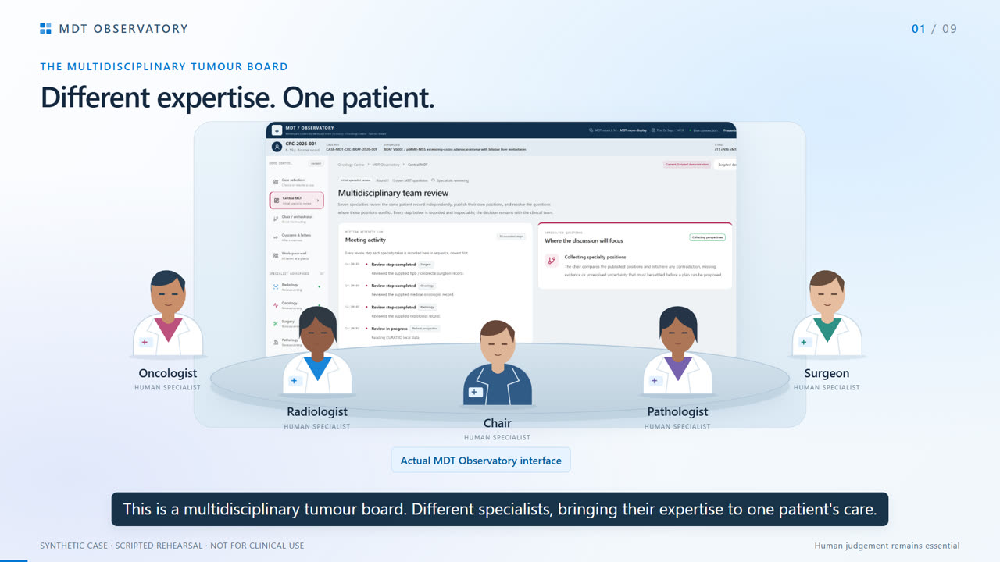

# MDT Observatory

An agentic-first oncology multidisciplinary team (MDT) demonstrator. Seven
specialists inspect a supplied demonstration case through different tools and contexts,
publish structured positions, investigate disagreement and request human judgment.
The chair coordinates the process; it does not independently prescribe treatment.

**DEMONSTRATION SYSTEM. NOT FOR CLINICAL USE. No real patient data.**
Confidence is an illustrative model assessment, not a calibrated medical probability.

[](https://github.com/jochenvw/mdt-observatory/releases/download/explainer-film-v1/mdt-observatory-explainer.mp4)

▶ **[Watch the three-minute explainer film](https://github.com/jochenvw/mdt-observatory/releases/download/explainer-film-v1/mdt-observatory-explainer.mp4)**
(MP4, 45 MB, English narration with captions; [release page](https://github.com/jochenvw/mdt-observatory/releases/tag/explainer-film-v1)).

Hosted demo (Health Rewired Munich 2026):
<https://mdt-observatory-vnet.delightfulfield-8de6d3f0.westeurope.azurecontainerapps.io>.
Participants open the URL, or scan the QR code on the presenter's Join screen, and
pick a role; no key is needed. The demo team unlocks case selection and the chair
controls with the presenter token from the Git-ignored, current-user-restricted
`.azure\presenter-token.txt`; never publish that file. See the
[room setup](docs/demo.md#room-setup-health-rewired-munich-2026). Rehearsal takes about
60-90 seconds; the real Azure-model walkthrough takes about eight minutes on
the configured shared quota.

## Run locally

Prerequisites: Python 3.12+, [uv](https://docs.astral.sh/uv/), Node.js 22+.

```powershell
uv sync --frozen
Set-Location frontend
npm ci
npm run build
Set-Location ..
uv run --frozen uvicorn mdt.app:app --host 127.0.0.1 --port 8000
```

Open <http://127.0.0.1:8000>. When Azure OpenAI is configured, the default is
**Live AI review** (`azure`). The deterministic **Scripted demonstration**
(`rehearsal`) remains selectable, uses curated tools, needs no Azure credentials
and never claims to be live AI.
Start a case, investigate friction, steer radiology, request targeted follow-up,
and explicitly concur from roles that require human review.

For frontend development, run `npm run dev` in `frontend` alongside the API.
The Vite server proxies `/api` to the local API.

The interface is built with **Tailwind CSS**. The light/dark control remembers
your choice, with the operating-system theme as the initial default. Each
specialty has its own layout and color treatment rather than a renamed copy of
one dashboard. Activity describes clinical review tasks; engineering metadata
is retained in the audit export and telemetry, not shown in the clinical feed.

## Live Azure agents

```powershell
az login
$env:AZURE_OPENAI_ENDPOINT = "https://<account>.openai.azure.com"
$env:AZURE_OPENAI_DEPLOYMENT = "<deployment>"
uv run --frozen uvicorn mdt.app:app --host 127.0.0.1 --port 8000
```

Select **Live AI review** (`azure`) when starting a new meeting. Each specialist gets its own
context, prompt, allowlisted tools and structured response. Authentication uses
Azure Identity (local Azure CLI or deployed managed identity). The identity needs
**Cognitive Services OpenAI User** on the model account. Model failures surface
as failed roles and block consensus; the app never silently switches to rehearsal.

Outcome documents (the patient summary and letter to the accountable medical doctor) always need this model
configuration, including in the scripted demonstration. Without it, they fail
visibly and no scripted text is substituted.

Live mode runs real model calls over **curated evidence tools**, not unrestricted
live medical research. Access labels describe the underlying source and the
recorded extract; no paywall bypass or invented protocol access is implied.
See [evidence provenance](docs/evidence.md).

Specialist reviews run concurrently, with a default limit of three:

```powershell
$env:MDT_AZURE_MAX_CONCURRENT_ROLES = "3" # 1-7; restart the API after changing
$env:MDT_AZURE_REQUEST_INTERVAL_SECONDS = "20"
```

Request pacing and rate-limit cooldowns are shared across roles. The current
deployment is allocated 10,000 tokens/minute and 10 requests/minute; increasing
concurrency alone does not increase that capacity. See [operations](docs/operations.md)
for deployment flags and the proposed higher-capacity configuration.

## The demonstration

The current case comes from [`case.md`](case.md), the supplied source file
(`case.txt` was not present). It concerns a 59-year-old woman with BRAF V600E,
pMMR/MSS ascending-colon cancer and nine bilobar liver metastases after four cycles
of encorafenib, cetuximab and mFOLFOX6. The MDT weighs local clearance now,
additional systemic therapy with reassessment, and deferred local treatment.
Marked response does not settle the persistent ctDNA, indeterminate lung nodule
or the question of durable disease control.

The complete clinical dossier is retained with its source values, dates and units.
The source's academic profile is background material, not an agent identity;
no real clinician is impersonated. Source-supplied literature claims are distinct
from independently verified external evidence. Historic meetings remain readable
and exportable; start a new case to use the new dossier.

1. **Activate.** All seven role workspaces react to the same case.
2. **Observe.** Tools, evidence, uncertainty and structured positions arrive live.
3. **Investigate.** The chair identifies imaging ambiguity and evidence applicability.
4. **Steer.** Ask radiology to review all nine original liver sites, vessel margins
   and the indeterminate lung nodule before clearance planning.
5. **Reconcile.** Targeted follow-up updates only roles with open questions.
6. **Review.** A conditional proposal requests version-bound concurrence. An
   objection reopens discussion and invalidates earlier votes.
7. **Capture.** The final decision contains the full event history, role positions,
   human contributions, evidence, residual uncertainty and objections.
8. **Communicate.** **Outcome & letters** shows the agreed plan forward and drafts
   a patient summary in the patient's language, plus an English letter to the accountable medical doctor,
   for named clinician approval.

See [demo walkthrough](docs/demo.md), [architecture](docs/architecture.md) and
[operations](docs/operations.md).

### Explainer film

[Watch the film](https://github.com/jochenvw/mdt-observatory/releases/download/explainer-film-v1/mdt-observatory-explainer.mp4)
(release asset; rendered output is not committed). [`video`](video/README.md) contains
the source of this reproducible three-minute, Microsoft-inspired
Remotion film made from the actual local interface and synthetic rehearsal case.
It includes browser capture, English narration, captions and rendering commands.
The film preserves human-review gates and explicitly labels illustrative letter
excerpts where model-backed drafting is unavailable.

### Running the room across several screens

The meeting room is a single shared room, so the demonstration can be run with one
orchestrator screen and a screen per participant, each on its own machine.

1. Every participant opens the shared URL (no key), lands on the join screen and
   picks their specialty. Each screen
   shows a specialty-branded standby view: it is connected to the room, states that
   no patient record is loaded, and lists what that specialty will be responsible for.
2. The orchestrator (presenter key) selects a case and starts the meeting. Every open screen leaves
   standby and fills with that case, and each specialty then follows its own
   reasoning as it is produced.
3. When the meeting has finished, the orchestrator uses **Clear the room**, available
   both on the chair control and on the case-selection screen next to the current
   meeting. Every screen is wiped back to the standby view and nothing from that
   meeting is shown on it any more.
4. The orchestrator can then start the next case and every screen repopulates from
   scratch with the new dossier.

Returning the room to standby is an explicit orchestrator action, not an automatic
consequence of reaching consensus: the captured decision stays on screen for
discussion until the room is cleared. Clearing does not delete anything. The meeting
is kept and stays readable and exportable through its record; only the live room is
emptied, and the reset is recorded on the meeting's own activity trail. The reset is
durable, so restarting the service does not bring a closed case back onto the screens.
The control is refused while a round is still running, so a meeting in
progress cannot be cleared out from under the participants.

## Quality gates

```powershell
uv run --frozen ruff check .
uv run --frozen mypy
uv run --frozen pytest --cov=mdt
Set-Location frontend
npm test
npm run build
Set-Location ..
uv run --frozen playwright install chromium
$env:MDT_BROWSER_TESTS = "1"
uv run --frozen pytest tests\test_browser.py -q
```

Browser tests and Azure verification instructions are documented in
[operations](docs/operations.md). `--frozen` ensures workstation registry overrides
do not rewrite the verified public-registry lockfile during a demo.
The implementation/deployment checkpoint record
is [.azure/deployment-plan.md](.azure/deployment-plan.md).
Observed results and reproduction commands are in [verification](docs/verification.md).

To run the same browser acceptance against Azure, set `MDT_BROWSER_URL` to the
deployed HTTPS URL and `MDT_PRESENTER_TOKEN` to the presenter secret, then run
the browser command above. It creates demonstration meetings in the shared demo
room; do not run it during someone else's presentation.

## Boundaries

- One shared presenter room, one process and one container replica. Not a
  multi-tenant, horizontally scaled or production clinical architecture.
- Only the curated demonstration case can be activated; there is no patient upload.
- Cloud access has two tiers. Anyone with the URL can follow the room and act for
  a specialty (steer, answer, concur, object). Running the meeting needs a presenter
  token and a signed, HTTP-only, same-site cookie.
  This is demo access control, not clinical identity or legally valid signatures.
  Ten failed sign-ins per client per minute are throttled; a correct token is
  never throttled, so others' failures cannot lock the presenter out. In Azure,
  `FORWARDED_ALLOW_IPS` trusts `X-Forwarded-For` only from the Container Apps
  subnet, so the client address is the one the ingress recorded.
- Commands are same-origin JSON with a declared `Content-Length` of at most
  16 KB; chunked or unsized bodies are refused before they are read.
- Local SQLite snapshots preserve events and decisions. Azure uses atomic JSON
  snapshots in Blob Storage through a private endpoint and managed identity,
  with ETags rejecting stale writes. Storage public access and Shared Key remain
  disabled; the app does not request a governance exemption.
- Closed decisions are immutable through the API. Starting another case preserves
  the previous record. At 100 meetings the app requests archival rather than
  silently deleting history.
- Memory is explicit, role/clinician scoped and labeled by category. Forgetting
  removes a nudge from the active meeting, not historical clinical/audit records.
- Comparable historical cases are descriptive, not advisory. No governed registry
  is connected, so the cohort is a deterministic synthetic dataset, labeled as
  such on screen and in exports, and is never clinical evidence. It never ranks,
  prefers or recommends a treatment, cohorts and site subgroups below the
  configured minimum size (`MDT_COHORT_MINIMUM_SUBGROUP`, default 15) are
  suppressed, and a quoted cohort finding is recorded as context that decides
  nothing.
- No real clinician impersonation, stereotyping, EHR integration or raw
  chain-of-thought exposure.
