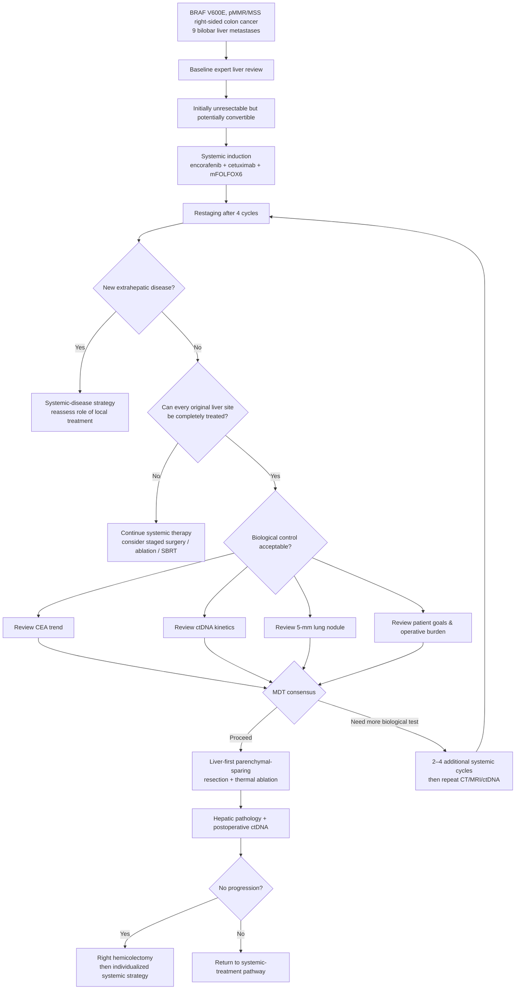

# Fictional precision-CRC MDT case

## Executive summary

The synthetic MDT case below concerns **right-sided, pMMR/MSS, BRAF V600E-mutant colon cancer with extensive initially unresectable bilobar liver metastases that responds substantially to first-line molecularly targeted systemic treatment and may now have become locally treatable**. The deliberately difficult MDT question is not simply “which drug?” but **whether biological response should trigger curative-intent liver surgery, whether systemic therapy should be prolonged to establish disease control, how to deal with an indeterminate lung nodule, and how to reconcile modern BRAF-targeted data with CAIRO5's conversion-therapy evidence**. BREAKWATER has moved first-line BRAF V600E treatment toward encorafenib–cetuximab plus mFOLFOX6, while CAIRO5 supplies unusually relevant evidence about conversion of initially unresectable liver metastases; no randomized trial directly answers the combined question posed by this case. citeturn30search1turn30search3turn26search8turn24view1

**Important:** every patient identifier, date, laboratory value, image measurement, DICOM-like UID, pathology result and genomic result in the case below is fictional and generated specifically for this MDT simulation. It does not represent a real patient.

## Source-supplied research context

Opaque citation tokens in this document are source-supplied and unverified; they are not resolved references. Academic biographies and contributor framing have been removed by authorization. Clinical YAML fields are unchanged.

| Publication / program | Why it matters |
|---|---|
| **CAIRO, Lancet 2007** | Phase III study of 820 patients comparing sequential use of capecitabine, irinotecan and oxaliplatin with upfront combination strategies. It helped establish that treatment sequencing can be a legitimate clinical strategy rather than assuming maximal initial combination therapy is always necessary. citeturn23search2 |
| **CAIRO3, Lancet 2015** | Randomized 558 patients who had disease control after CAPOX-bevacizumab to capecitabine–bevacizumab maintenance or observation. Median PFS2 was 11.7 versus 8.5 months, HR 0.67; quality of life was not clinically worsened by maintenance. citeturn24view2 |
| **CAIRO5, Lancet Oncology 2023** | One of the most directly relevant trials for CRC liver MDT practice: patients with initially unresectable colorectal liver metastases underwent predefined expert-panel assessment and molecularly/sidedness-stratified first-line systemic treatment. The original report favored FOLFOXIRI–bevacizumab for right-sided and/or RAS/BRAF V600E-mutant disease because of its induction activity, while panitumumab added to doublet chemotherapy did not produce a clinical local-treatment advantage in left-sided RAS/BRAF-wild-type disease despite greater response. citeturn26search8 |
| **CAIRO5 long-term analysis, JAMA Oncology 2025** | Particularly important for MDT controversy: longer follow-up called attention to the fact that greater response or conversion rates do not automatically translate into a survival advantage and supported doublet chemotherapy plus bevacizumab as a defensible strategy in initially unresectable CRLM. citeturn24view1turn26search1 |
| **PROVENC3, British Journal of Surgery 2025/2026** | Prospective postoperative ctDNA study in 209 stage III colon-cancer patients. Postoperative ctDNA positivity was associated with markedly worse time to recurrence, HR 6.2; after adjuvant therapy, detectable ctDNA was associated with HR 7.9. Combining pathology and ctDNA produced very wide risk separation. citeturn24view3 |
| **Tumor-burden quantification using deep-learning imaging, European Journal of Cancer 2026** | Reflects a shift from conventional categorical burden measures toward quantitative image-derived number and volume of metastases and exploration of tumor burden as a prognostic and potentially treatment-interaction biomarker. citeturn6search0 |
| **RASTRIC, British Journal of Cancer 2026** | Phase I/II translational study of lapatinib, binimetinib and vinorelbine in RAS-mutant metastatic CRC, illustrating involvement in mechanism-driven early drug development rather than only conventional chemotherapy trials. citeturn6search3 |
| **DEBIR90Y, JVIR 2026** | Prospective phase I dose-escalation study combining ^90Y glass-microsphere radioembolization with irinotecan drug-eluting-bead therapy in unresectable liver-dominant CRLM. Twelve patients were treated; 80 Gy was identified as the maximum tolerated normal-liver dose in the tested combination, with substantial toxicity and limited overall response, making it instructive as much for limitations as promise of aggressive locoregional therapy. citeturn28search12 |
| **ACSI cohort, Acta Oncologica 2026** | National prospective work in small-intestinal adenocarcinoma, a rare disease in which randomized evidence is limited. The cohort integrates clinical, molecular and patient-reported information; the initial report included 143 participants and found dMMR in a substantial subset. citeturn1view3turn6search6 |

The clinical questions span **“which chemotherapy sequence?” → “how should active therapy be maintained?” → “can systemic treatment convert metastatic disease to local treatment?” → “can biomarkers, imaging, ctDNA and real-world data determine who actually needs which treatment?”** citeturn23search2turn24view2turn26search8turn24view3turn27search3

### Source-supplied ongoing-study context

PLCRC itself remains the central ongoing infrastructure. It prospectively collects clinical data, patient-reported outcomes and biospecimens and is explicitly designed to host additional intervention studies. citeturn27search3turn27search7

Several PLCRC-linked studies remain publicly listed as open for inclusion at participating Dutch centers. These include **DOLPHIN**, studying liquid-biopsy testing for care closer to home; **MEDOCC**, investigating the prognostic value of ctDNA in stage II/III CRC; and **MEDOCC-CREATE**, evaluating ctDNA-based adjuvant chemotherapy strategies in stage II colon cancer. This source-supplied listing is not verified current trial eligibility or an enrollment offer. citeturn29view3

This is also consistent with PLCRC's increasing use as a bridge between routine care and research: the infrastructure allows linkage of clinical outcomes, questionnaires and biomaterial, while the Dutch Cancer Registry can be linked to PLCRC for selected research questions. citeturn27search10turn27search3

For contemporary metastatic BRAF V600E CRC, the therapeutic landscape has changed particularly rapidly. BREAKWATER demonstrated superior first-line outcomes with **encorafenib plus cetuximab and mFOLFOX6** compared with standard therapy; an earlier analysis showed a confirmed response rate of 60.9% versus 40.0%, and the subsequent phase III report showed significantly longer progression-free and overall survival. citeturn30search3turn30search1 The Dutch NVMO's current advice list includes encorafenib, cetuximab and chemotherapy for metastatic BRAF V600E-mutant CRC as of July 2026. citeturn29view2 This new evidence creates exactly the sort of tension with conversion-specific CAIRO5 evidence that a contemporary expert MDT must now resolve.

## Full synthetic MDT case dossier

**Use case:** advanced colorectal-cancer MDT / conversion-to-resectability simulation.

**Primary learning question:** *Does a major early molecular and radiological response in BRAF V600E metastatic colon cancer justify moving from systemic treatment to curative-intent local therapy when the evidence supporting the systemic regimen and the evidence supporting conversion surgery come from different trial populations?*

The choice of BRAF-mutant, liver-dominant CRC connects CAIRO5's conversion framework, PLCRC-style biomarker research and current biomarker-directed systemic therapy. citeturn26search8turn27search3turn30search1

```yaml
case:
  case_id: "SYN-MDT-CRC-BRAF-2026-001"
  synthetic: true
  simulation_date: "2026-09-16"
  title: >
    BRAF V600E right-sided colon cancer with initially unresectable
    bilobar liver metastases after major early response to
    encorafenib/cetuximab/mFOLFOX6
  primary_mdt_question: >
    Has systemic treatment converted the hepatic disease to a state
    in which curative-intent local therapy is justified now, or should
    systemic treatment continue to establish deeper and more durable
    disease control?

patient:
  age: 59
  sex_at_birth: female
  gender: woman
  ethnicity: "Dutch/European ancestry"
  occupation: "secondary-school administrator"
  height_cm: 169
  weight_kg_at_diagnosis: 72.4
  bmi: 25.4
  ECOG_performance_status: 1
  frailty_screen: "G8 16/17; not frail"
  living_situation: "lives with partner; two adult children"
  smoking: "never smoker"
  alcohol: "approximately 3 units/week"
  goals:
    - "maximize probability of long-term disease control or cure"
    - "accept substantial short-term toxicity if curative intent is credible"
    - "strong preference to preserve independence and avoid permanent stoma"

presenting_history:
  symptom_onset: "2026-05-04"
  symptoms:
    - "progressive fatigue"
    - "exertional dyspnea"
    - "intermittent right-upper-quadrant pressure"
    - "change to softer stools, 2-3/day"
    - "4.8 kg unintentional weight loss over 10 weeks"
  absent_symptoms:
    - "no complete obstruction"
    - "no overt hematochezia"
    - "no vomiting"
    - "no ascites"
    - "no jaundice"
  physical_exam:
    pulse_bpm: 88
    blood_pressure_mmHg: "138/82"
    temperature_C: 36.7
    oxygen_saturation_percent: 98
    abdomen: >
      soft; mild right-upper-quadrant fullness; liver edge just palpable;
      no guarding, ascites, or clinically palpable mass
    rectal_exam: "no palpable rectal lesion"

medical_history:
  comorbidities:
    - condition: "essential hypertension"
      status: "controlled"
    - condition: "type 2 diabetes mellitus"
      status: "HbA1c 48 mmol/mol; no established neuropathy or nephropathy"
    - condition: "hypercholesterolemia"
      status: "controlled"
    - condition: "provoked left popliteal DVT after ankle fracture"
      year: 2019
      status: "completed anticoagulation; no recurrence"
    - condition: "migraine without aura"
      status: "infrequent"
  prior_surgery:
    - "laparoscopic cholecystectomy, 2012"
    - "open reduction/internal fixation left ankle, 2019"
  allergies:
    - "no known drug allergies"
  family_history:
    father: "colon cancer at age 73"
    mother: "alive, no malignancy"
    sibling: "sister with advanced adenoma at age 61"
    hereditary_pattern: "no obvious Lynch-spectrum clustering"

baseline_medications:
  - "losartan 50 mg PO once daily"
  - "amlodipine 5 mg PO once daily"
  - "metformin XR 1000 mg PO with evening meal"
  - "rosuvastatin 10 mg PO nightly"
  - "paracetamol 1000 mg PO up to three times daily PRN"
  - "oral ferrous fumarate initially prescribed; stopped after IV iron"

diagnostic_timeline:
  - date: "2026-05-22"
    event: "GP blood testing demonstrates microcytic iron-deficiency anemia"
  - date: "2026-06-03"
    event: "colonoscopy: malignant ascending-colon mass; biopsied"
  - date: "2026-06-06"
    event: "contrast CT chest/abdomen/pelvis"
  - date: "2026-06-11"
    event: "gadoxetate-enhanced liver MRI"
  - date: "2026-06-15"
    event: "18F-FDG PET/CT for potentially curable metastatic work-up"
  - date: "2026-06-18"
    event: "central pathology and molecular report finalized"
  - date: "2026-06-19"
    event: "first metastatic CRC MDT"
  - date: "2026-07-06"
    event: "systemic cycle 1"
  - date: "2026-07-20"
    event: "cycle 2"
  - date: "2026-08-03"
    event: "cycle 3"
  - date: "2026-08-17"
    event: "cycle 4"
  - date: "2026-09-02"
    event: "response CT"
  - date: "2026-09-08"
    event: "response liver MRI and volumetry"
  - date: "2026-09-16"
    event: "conversion MDT: current decision point"

baseline_laboratory_results:
  date: "2026-06-04"
  hematology:
    hemoglobin_g_dL: 9.4
    MCV_fL: 72
    WBC_x10e9_L: 9.2
    ANC_x10e9_L: 6.8
    platelets_x10e9_L: 498
  iron:
    ferritin_ug_L: 9
    transferrin_saturation_percent: 6
  renal_metabolic:
    creatinine_umol_L: 74
    eGFR_mL_min_1_73m2: 88
    sodium_mmol_L: 139
    potassium_mmol_L: 4.2
    calcium_mmol_L: 2.32
    magnesium_mmol_L: 0.79
  liver:
    bilirubin_umol_L: 8
    albumin_g_L: 37
    ALP_U_L: 182
    GGT_U_L: 136
    ALT_U_L: 39
    AST_U_L: 44
    LDH_U_L: 348
  inflammation:
    CRP_mg_L: 42
  coagulation:
    INR: 1.0
  metabolic:
    HbA1c_mmol_mol: 48

tumor_markers:
  baseline:
    date: "2026-06-04"
    CEA_ug_L: 216
    CA19_9_kU_L: 178
  after_cycle_2:
    date: "2026-07-31"
    CEA_ug_L: 82
    CA19_9_kU_L: 96
  after_cycle_4:
    date: "2026-09-01"
    CEA_ug_L: 31.6
    CA19_9_kU_L: 44

colonoscopy:
  date: "2026-06-03"
  site: "ascending colon, approximately 5 cm distal to hepatic flexure"
  lesion:
    morphology: "ulcerated near-circumferential exophytic mass"
    length_mm: 55
    luminal_narrowing_percent: 55
    traversable: true
  additional_findings:
    - "8 mm sigmoid tubular adenoma, removed"
  obstruction: false
  active_bleeding: false

imaging:
  baseline_CT_CAP:
    date: "2026-06-06"
    technique:
      modality: "CT"
      manufacturer: "Siemens Healthineers"
      model: "SOMATOM Force"
      tube_voltage_kVp: 120
      reconstruction_slice_thickness_mm: 1.0
      IV_contrast: "iopromide 370 mg I/mL, 95 mL"
      injection_rate_mL_s: 3.5
      abdominal_phase: "portal venous, approximately 70 seconds"
      StudyInstanceUID: "1.2.826.0.1.3680043.10.543.20260606.1001"
    primary:
      site: "ascending colon"
      craniocaudal_length_mm: 56
      maximal_wall_thickness_mm: 18
      extramural_extension_mm: 6
      suspected_stage: "cT3"
      obstruction: false
      perforation: false
    regional_nodes:
      ileocolic_node_1_mm: "14 x 11"
      ileocolic_node_2_mm: "11 x 9"
      interpretation: "radiologically suspicious; cN1b favored"
    liver:
      lesion_count_CT: 8
      distribution: "bilobar"
      target_lesions:
        - segment: "8"
          size_mm: "48 x 43"
        - segment: "4a"
          size_mm: "36 x 31"
          vascular_relationship: "broad contact with middle hepatic vein"
        - segment: "7"
          size_mm: "33 x 28"
        - segment: "3"
          size_mm: "26 x 22"
      additional_lesions: "segments 6, 5, 2 and 1"
    lung:
      finding: "5 mm solid right-upper-lobe subpleural nodule"
      interpretation: "indeterminate; too small for confident characterization"
    peritoneum: "no visible peritoneal metastases"
    distant_nodes: "none pathologically enlarged"
    ascites: "none"

  baseline_liver_MRI:
    date: "2026-06-11"
    technique:
      modality: "MRI"
      field_strength_T: 3.0
      manufacturer: "Siemens Healthineers"
      model: "MAGNETOM Vida"
      contrast: "gadoxetate disodium 0.025 mmol/kg"
      DWI_b_values_s_mm2: [50, 400, 800]
      hepatobiliary_phase_min: 20
      slice_thickness_mm: 3
      StudyInstanceUID: "1.2.826.0.1.3680043.10.543.20260611.2001"
    metastatic_lesions:
      - {segment: "8", size_mm: "48 x 43"}
      - {segment: "4a", size_mm: "36 x 31"}
      - {segment: "7", size_mm: "33 x 28"}
      - {segment: "6", size_mm: "24 x 20"}
      - {segment: "5", size_mm: "14 x 12"}
      - {segment: "3", size_mm: "26 x 22"}
      - {segment: "2", size_mm: "13 x 11"}
      - {segment: "1", size_mm: "18 x 15"}
      - {segment: "4b", size_mm: "11 x 9"}
    lesion_count: 9
    lesion_characteristics: >
      restricted diffusion; peripheral/rim enhancement; hypointense on
      hepatobiliary phase, typical for metastases
    surgically_critical_relationships:
      - >
        segment 4a lesion contacts approximately 140 degrees of the middle
        hepatic vein over 22 mm
      - >
        segment 1 lesion lies approximately 3 mm anterior to the IVC
      - >
        segment 8 lesion approaches the right anterior portal pedicle
    liver_volume:
      total_functional_liver_mL: 1640
      estimated_FLR_if_right_trisectionectomy_mL: 377
      estimated_FLR_percent: 23
    baseline_resectability_opinion: >
      not safely clearable by a conventional single major hepatectomy
      with an acceptable future liver remnant; technically initially
      unresectable, but potentially convertible

  baseline_FDG_PET_CT:
    date: "2026-06-15"
    technique:
      tracer: "18F-FDG"
      injected_activity_MBq: 211
      uptake_time_min: 62
      preinjection_glucose_mmol_L: 5.8
      scanner: "Siemens Biograph Vision"
      StudyInstanceUID: "1.2.826.0.1.3680043.10.543.20260615.3001"
    primary:
      SUVmax: 18.1
    liver:
      most_avid_lesion: "segment 8"
      SUVmax: 12.6
    lung_nodule:
      FDG_avid: false
      caveat: "below reliable PET spatial resolution"
    other_disease: "no FDG-avid bone, peritoneal or distant nodal metastases"

pathology:
  primary_colon_biopsy:
    specimen_id: "SYN-PATH-26-0618-A"
    histology: >
      invasive colorectal adenocarcinoma, moderately to poorly differentiated,
      with focal cribriform architecture and approximately 10% extracellular
      mucin
    grade: "G2-G3 on biopsy"
    necrosis: "focal dirty necrosis"
    lymphovascular_invasion: "cannot be reliably assessed in superficial biopsy"
    perineural_invasion: "not assessable"
    immunohistochemistry:
      AE1_AE3: "positive"
      CK20: "patchy positive"
      CDX2: "diffuse positive"
      SATB2: "diffuse positive"
      CK7: "negative"
      synaptophysin: "negative"
      chromogranin_A: "negative"
      HER2: "IHC 1+; negative"
      BRAF_VE1: "diffuse cytoplasmic positive"
    mismatch_repair:
      MLH1: "retained"
      PMS2: "retained"
      MSH2: "retained"
      MSH6: "retained"
      interpretation: "MMR proficient"

molecular_profile:
  assay: "synthetic hybrid-capture 500-gene DNA panel"
  tumor_cellularity_percent: 55
  variants:
    - gene: "BRAF"
      HGVS_c: "c.1799T>A"
      HGVS_p: "p.Val600Glu"
      classification: "pathogenic"
      tissue_VAF_percent: 34.6
    - gene: "APC"
      HGVS_c: "c.3927_3931del"
      HGVS_p: "p.Glu1309Aspfs*4"
      classification: "pathogenic"
      tissue_VAF_percent: 41.2
    - gene: "TP53"
      HGVS_c: "c.743G>A"
      HGVS_p: "p.Arg248Gln"
      classification: "pathogenic"
      tissue_VAF_percent: 28.7
    - gene: "SMAD4"
      HGVS_c: "c.1082G>A"
      HGVS_p: "p.Arg361His"
      classification: "likely pathogenic"
      tissue_VAF_percent: 18.4
  negative_predictive_findings:
    KRAS: "wild type"
    NRAS: "wild type"
    ERBB2_amplification: "not detected"
    NTRK1_2_3_fusion: "not detected"
    RET_fusion: "not detected"
  microsatellite_status: "MSS"
  tumor_mutational_burden_mut_Mb: 5.8
  POLE_POLD1_pathogenic_variant: "not detected"

pharmacogenomics:
  DPYD: "no decreased-function variants detected; activity score 2.0"
  UGT1A1: "*1/*28"

baseline_ctDNA:
  date: "2026-06-23"
  assay: "synthetic tumor-informed plasma assay"
  findings:
    BRAF_V600E_VAF_percent: 11.8
    APC_pGlu1309fs_VAF_percent: 13.6
    TP53_R248Q_VAF_percent: 9.4
  qualitative_result: "strongly positive"

baseline_stage:
  TNM_AJCC8: "cT3 cN1b cM1a"
  stage_group: "Stage IVA"
  metastatic_sites_proven_or_highly_probable:
    - "liver"
  indeterminate_sites:
    - "5 mm right-upper-lobe pulmonary nodule"
  disease_pattern: "liver-dominant; no confirmed extrahepatic metastasis"

initial_mdt_assessment:
  date: "2026-06-19"
  primary_tumor_status: "asymptomatic/nonobstructing; no urgent colectomy indication"
  liver_status: "initially unresectable but potentially convertible"
  treatment_goal: >
    systemic disease control with explicit reassessment for curative-intent
    local treatment
  controversies:
    - >
      contemporary BRAF-targeted first-line therapy versus a conversion-focused
      FOLFOXIRI/bevacizumab strategy
    - >
      whether the 5 mm lung nodule should prevent a liver-only curative strategy
    - >
      whether early colectomy adds anything when the asymptomatic liver burden
      is the life-limiting component

prior_cancer_treatment:
  systemic_regimen:
    name: "encorafenib + cetuximab + mFOLFOX6"
    rationale: >
      selected after molecular confirmation of BRAF V600E mutation,
      with explicit reassessment for conversion
    cycles_completed: 4
    cycle_dates:
      - "2026-07-06"
      - "2026-07-20"
      - "2026-08-03"
      - "2026-08-17"
    regimen_details:
      encorafenib: "300 mg PO once daily"
      cetuximab: "500 mg/m2 IV every 14 days"
      oxaliplatin: "85 mg/m2 IV every 14 days"
      leucovorin: "institutional mFOLFOX6 dosing"
      fluorouracil: "mFOLFOX6 bolus/46-hour infusion per institutional protocol"
  supportive_treatment:
    - "ferric carboxymaltose IV, total 1000 mg"
    - "prophylactic doxycycline for EGFR-inhibitor rash"
    - "topical hydrocortisone/emollient regimen"
    - "magnesium supplementation after cycle 3"
    - "standard antiemetic prophylaxis"
  maximum_toxicities:
    acneiform_rash: "CTCAE grade 2"
    sensory_neuropathy: "grade 1, cold-triggered"
    fatigue: "grade 1"
    hypomagnesemia: "grade 2"
    neutropenia: "grade 1"
    diarrhea: "grade 1"
    febrile_neutropenia: "none"

response_assessment:
  CT:
    date: "2026-09-02"
    primary_colon_mass_length_mm: 37
    nodes:
      largest_ileocolic_node_mm: "8 x 6"
    liver_target_lesions:
      segment_8_mm: "29 x 25"
      segment_4a_mm: "20 x 17"
      segment_7_mm: "18 x 15"
      segment_3_mm: "14 x 11"
    RECIST_1_1_assessment: "partial response"
    right_upper_lobe_nodule: "5 mm, unchanged"
    new_lesions: "none"

  liver_MRI:
    date: "2026-09-08"
    viable_lesions_visible: 9
    measurements:
      S8_mm: "29 x 25"
      S4a_mm: "20 x 17"
      S7_mm: "18 x 15"
      S6_mm: "12 x 10"
      S5_mm: "8 x 6"
      S3_mm: "14 x 11"
      S2_mm: "7 x 6"
      S1_mm: "10 x 8"
      S4b_mm: "6 x 5"
    vascular_relationship_changes:
      S4a: >
        major reduction; now approximately 2 mm from the middle hepatic vein
        without circumferential involvement
      S1: "still approximately 3 mm from IVC"
    volumetry:
      total_functional_liver_mL: 1665
      parenchymal_sparing_strategy_expected_remnant_percent: ">65"
    radiology_conclusion: >
      substantial response; all currently visible hepatic deposits appear
      potentially clearable by combined parenchymal-sparing resection and
      thermal ablation in an expert hepatobiliary unit

  biomarkers:
    date: "2026-09-09"
    CEA_ug_L: 31.6
    CA19_9_kU_L: 44
    ctDNA:
      BRAF_V600E_VAF_percent: 0.42
      APC_variant_VAF_percent: 0.55
      TP53_variant_VAF_percent: 0.31
      interpretation: "major molecular response but persistent detectable ctDNA"

post_cycle_4_labs:
  date: "2026-09-09"
  hemoglobin_g_dL: 11.4
  platelets_x10e9_L: 287
  ANC_x10e9_L: 2.8
  bilirubin_umol_L: 7
  albumin_g_L: 40
  ALP_U_L: 124
  AST_U_L: 31
  ALT_U_L: 34
  creatinine_umol_L: 70
  magnesium_mmol_L: 0.61
  CRP_mg_L: 9

current_resectability_review:
  date: "2026-09-16"
  HPB_surgeon_opinion: >
    conversion from technically unresectable to potentially completely
    locally treatable disease
  proposed_liver_strategy:
    - "segment 8 parenchymal-sparing metastasectomy"
    - "segment 4a wedge/resection with middle hepatic vein preservation if possible"
    - "segment 7 wedge resection"
    - "thermal ablation of selected deep segment 6, 3 and 1 lesions"
    - "intraoperative ultrasound to identify chemotherapy-altered/disappearing lesions"
  PVE_required: "probably not if parenchymal-sparing plan feasible"
  alternative_if_S1_or_S4a_not_safely_clearable:
    - "staged approach"
    - "stereotactic radiotherapy/MR-guided radiotherapy"
    - "additional systemic therapy with subsequent reassessment"
  colon_strategy_options:
    - "liver-first; delayed right hemicolectomy"
    - "synchronous right hemicolectomy if hepatic procedure remains limited"
    - "continue systemic therapy and defer colectomy"
  curative_intent_possible: "yes, but biologically uncertain"

differential_diagnoses:
  liver:
    leading: "colorectal liver metastases"
    alternatives:
      - "multifocal intrahepatic cholangiocarcinoma: very unlikely"
      - "multifocal benign lesions: inconsistent with MRI/PET and treatment response"
  lung_nodule:
    - "benign intrapulmonary lymph node/granuloma"
    - "very small colorectal metastasis"
    - "less likely primary lung neoplasm"
  primary_histology:
    - "conventional colorectal adenocarcinoma"
    - "adenocarcinoma with focal mucinous differentiation"
    - "medullary carcinoma unlikely given morphology and pMMR phenotype"
  anemia:
    - "chronic occult gastrointestinal blood loss"
    - "contribution from inflammation"

unresolved_mdt_questions:
  - >
    Is four cycles enough evidence of systemic disease control to interrupt a
    highly active first-line regimen for liver surgery?
  - >
    Does persistent low-level ctDNA argue against immediate metastasectomy,
    or does it simply reflect still-visible metastatic disease?
  - >
    Should a stable 5 mm pulmonary nodule be treated as presumed M1b disease
    and therefore lower enthusiasm for curative liver surgery?
  - >
    Should the colon primary be removed synchronously, after liver surgery,
    or only after additional demonstration of disease control?
  - >
    Is a combined resection/ablation strategy oncologically equivalent enough
    to justify avoiding a major hepatectomy?
  - >
    What duration of perioperative BRAF/EGFR-targeted treatment is reasonable
    when prospective perioperative data are sparse?
```

The initial systemic choice is deliberately debatable. BREAKWATER provides phase III evidence for first-line encorafenib–cetuximab plus mFOLFOX6 in BRAF V600E metastatic CRC, and the Dutch NVMO listed encorafenib/cetuximab/chemotherapy in its July 2026 advice. citeturn30search1turn30search3turn29view2 Yet the patient phenotype—**right-sided/BRAF-mutant, liver-only or nearly liver-only, initially unresectable but potentially convertible disease**—is also almost tailor-made for the clinical question addressed by CAIRO5, whose original analysis favored FOLFOXIRI–bevacizumab for this biological group. citeturn26search8

The persistent ctDNA after a large imaging response is intentionally provocative rather than diagnostically decisive. PROVENC3 concerns ctDNA as a powerful prognostic marker, but that study involved resected stage III colon cancer rather than metastatic patients undergoing conversion therapy; its hazard ratios therefore cannot simply be transplanted into this patient's peri-hepatectomy decision. citeturn24view3

**Suggested images immediately after the dossier:**  
A synthetic four-panel radiology plate would work especially well: axial portal-venous CT at baseline showing the 48-mm segment 8 and 36-mm segment 4a lesions; hepatobiliary-phase gadoxetate MRI showing all nine deposits; matched post-treatment MRI demonstrating shrinkage; and a 3-D liver map showing lesions, portal/hepatic veins, IVC and proposed resection/ablation zones. A second figure should plot CEA and ctDNA on a logarithmic scale against treatment cycles. A third could be an oncoprint showing **BRAF V600E / APC / TP53 / SMAD4**, MSS/pMMR status and the absence of RAS/HER2/NTRK alterations. These should be explicitly watermarked **SYNTHETIC — NOT CLINICAL IMAGING**.

## MDT interpretation, specialty positions and competing management plans

The current MDT should not reduce the question to “is the liver technically operable?” The more informative formulation is:

> **Has treatment transformed this patient from unresectable stage IV disease into a biological state in which complete local clearance has a credible chance of producing durable disease control?**

CAIRO5 is highly pertinent because resectability was repeatedly reviewed by a liver expert panel using predefined criteria, precisely recognizing that resectability is dynamic rather than a one-time staging label. citeturn26search3turn26search8 The important warning from its longer-term analysis is that **higher response and more aggressive cytoreduction cannot automatically be assumed to improve survival**, which should temper enthusiasm for equating an impressive scan with proof of curability. citeturn24view1turn26search1

### Specialty-specific MDT contributions

| Specialty | Interpretation | Specific MDT contribution |
|---|---|---|
| **Medical oncology** | Excellent early response to a contemporary BRAF-directed regimen, with a >80% CEA reduction and major plasma-VAF fall, but persistent measurable and molecular disease. | Decide whether four cycles provide sufficient systemic “test of time”; define perioperative interruption/restart strategy; balance further oxaliplatin exposure against the risk of delaying a window for complete local treatment. BREAKWATER supports the regimen's systemic efficacy, but did not specifically establish a conversion-hepatectomy pathway. citeturn30search1turn30search3 |
| **Hepatobiliary surgery** | Baseline disease was not safely treatable by conventional major resection; response has created a plausible parenchymal-sparing clearance strategy. | Confirm every original lesion can be addressed, including radiologically regressed lesions; use intraoperative ultrasound; determine one-stage versus staged liver clearance; protect adequate remnant liver and hepatic venous drainage. CAIRO5 demonstrates the importance of repeated expert surgical review. citeturn26search8 |
| **Colorectal surgery** | Primary remains nonobstructing and therefore has not forced the treatment sequence. | Compare liver-first, synchronous and staged colectomy. A liver-first approach minimizes interruption of management of the organ currently driving prognosis; synchronous surgery decreases total procedures but raises operative complexity. |
| **Radiology** | Imaging now suggests technically treatable disease, but the segment 1/IVC and segment 4a/MHV interfaces remain the principal anatomical risks. The 5-mm lung nodule cannot be reliably adjudicated by baseline PET. | Side-by-side baseline/current lesion mapping; liver volumetry; identify “disappearing” metastases; specifically document vessel distance and whether every baseline focus remains targetable. |
| **Interventional radiology** | Several deep lesions may be better treated by thermal ablation than by sacrificing major liver parenchyma. | Define safe ablation margins and whether lesions next to the IVC are susceptible to heat-sink or access limitations. DEBIR90Y is an interventional approach to liver-dominant CRC, although that phase I strategy itself showed considerable toxicity and limited overall response and is not a preferred solution for this potentially resectable patient. citeturn28search12 |
| **Radiation oncology** | Radiation is not the preferred method for clearing nine widespread liver lesions when surgical/ablative clearance is achievable, but it is valuable as a contingency for one anatomically unsafe residual focus. | Assess SBRT or MR-guided treatment particularly for the segment 1/IVC or segment 4a/MHV lesion if neither resection nor thermal ablation can achieve an acceptable local treatment. |
| **Pathology/molecular pathology** | The phenotype is unequivocally colorectal and BRAF V600E-driven, pMMR/MSS, RAS wild type and HER2-negative. | Review tumor heterogeneity; preserve tissue from any hepatic resection for treatment-effect assessment and research; compare metastatic molecular profile if unexpected progression occurs. |
| **Palliative/supportive care** | “Palliative care” here means symptom and decision support, not abandonment of curative intent. | Manage fatigue, rash, neuropathy, iron deficiency and uncertainty; establish how the patient values a substantial surgical burden against uncertain cure probability; ensure goals are revisited if extrahepatic disease declares itself. |

A central technical point is the **5-mm pulmonary nodule**. It should not be called PET-negative evidence of benignity: a lesion this small is below dependable PET characterization. In the simulation, stability through systemic treatment therefore leaves it genuinely indeterminate. The most defensible MDT behavior is serial thin-section CT rather than falsely resolving uncertainty.

A second controversy is **ctDNA**. The approximately 96% fall in synthetic BRAF VAF is biologically reassuring, while persistent positivity is worrying. Yet the relevant evidence base is still disease- and setting-dependent. PROVENC3 strongly supports postoperative ctDNA as a prognostic marker in resected stage III colon cancer, but it also showed that ctDNA-positive status was not synonymous with inevitable recurrence; extrapolating an absolute “do not operate” threshold to conversion-stage IV disease would be scientifically unjustified. citeturn24view3

### Three alternative management plans

| Management plan | Practical sequence | Principal advantages | Principal disadvantages / controversy | Evidence base |
|---|---|---|---|---|
| **Conversion strategy: move to liver-directed curative-intent treatment now** | Hold systemic treatment → expert parenchymal-sparing metastasectomies plus ablation of deep lesions → short-interval CT/ctDNA → staged right hemicolectomy if no progression → individualized postoperative systemic therapy. | Exploits the present window of technical resectability; minimizes additional oxaliplatin-related neuropathy and chemotherapy-associated liver injury; removes all radiographically visible dominant metastatic disease; provides hepatic pathology and treatment-response information. | Four cycles may be too short a “test of time” for biologically aggressive BRAF-mutant cancer; persistent ctDNA and the lung nodule could represent occult systemic disease; there is no randomized trial specifically validating hepatectomy after BREAKWATER therapy. | CAIRO5 validates repeated conversion assessment and local-treatment intent in initially unresectable CRLM, while BREAKWATER validates the systemic regimen—but the two evidence streams have not been prospectively combined. citeturn26search8turn30search1 |
| **Systemic-control strategy: continue EC + mFOLFOX6 for another two to four cycles before surgery** | Continue current regimen → repeat CT/MRI and ctDNA after approximately 8–12 additional weeks → operate only if no new disease and all lesions remain clearable. | Provides a stronger biological test of disease control; could deepen response and clarify the lung nodule; retains an evidence-based BRAF-directed first-line treatment that has demonstrated superior PFS/OS to standard therapy. | Potential loss of surgical window if resistant clones emerge; increasing neuropathy and liver injury; lesions can become difficult to identify after deep radiological response; persistent chemotherapy exposure may add toxicity without improving curability. | BREAKWATER phase III evidence strongly supports systemic efficacy. The unanswered question is optimal duration before conversion surgery. citeturn30search1turn30search3 |
| **Disease-control strategy: defer major surgery and prioritize systemic treatment with selective local consolidation** | Continue targeted systemic therapy; reserve ablation/SBRT for a threatening or oligoresidual lesion; resect primary only for symptoms or later strategic consolidation. | Lowest immediate operative burden; acknowledges the systemic biology of BRAF-mutant stage IV CRC; avoids a large multistep surgical program whose survival benefit is uncertain. | May forfeit a rare curative-intent opportunity after genuine conversion; systemic therapy alone is not synonymous with cure; local treatment later may become anatomically impossible. | Supported indirectly by the CAIRO5 long-term caution that more response/local treatment does not inherently guarantee survival improvement and by contemporary systemic efficacy data. It is not evidence that potentially curable liver-only disease should never be operated. citeturn24view1turn26search1turn30search1 |

### Preferred synthetic MDT position

For this **specific fictional patient**, the strongest MDT recommendation would be to **pursue curative-intent local treatment, but only after one final high-quality expert review confirms that every baseline liver site can be mapped and cleared and that repeat thin-slice chest CT shows no convincing pulmonary progression**. The preferred surgical architecture would be liver-first, parenchymal-sparing resection plus selected thermal ablation, rather than a right trisectionectomy requiring a marginal future liver remnant. This conclusion is an MDT inference from the case rather than a guideline-mandated answer.

The rationale is that the patient is young and fit, has no proven extrahepatic disease, has experienced substantial systemic, biochemical and molecular response, and has moved from anatomically unresectable to apparently clearable hepatic disease. Conversely, the recommendation should be presented to the patient as **potentially curative rather than predictably curative**, because BRAF V600E biology, persistent ctDNA and the unresolved pulmonary nodule all imply a substantial recurrence risk. The distinction between *technical resectability* and *oncological utility* is the key educational point.

A reasonable counter-position is to administer two additional cycles before surgery to strengthen the “test of time.” This is particularly defensible because BREAKWATER showed clear first-line efficacy for the current regimen and because the patient has not yet developed dose-limiting neuropathy. citeturn30search1turn30search3 The counterargument is that “more response” is not itself a validated surrogate for survival or better local-treatment outcome—one of the lessons emerging from the CAIRO5 program. citeturn24view1turn26search1

### MDT decision pathway



**Suggested figure placement — immediately below the flowchart:** a horizontal timeline from May to September 2026 displaying diagnosis, molecular results, each treatment cycle, CEA, ctDNA, CT/MRI response and the two MDT checkpoints. This would be especially effective in an MDT app because selecting each date could reveal the corresponding laboratory, imaging or pathology object.

## One-page clinician brief

**Synthetic patient:** 59-year-old woman, ECOG 1, controlled hypertension/type 2 diabetes, no major frailty. Presented May 2026 with iron-deficiency anemia, fatigue, weight loss and mild right-upper-quadrant discomfort. Colonoscopy demonstrated a nonobstructing 5.5-cm ascending-colon adenocarcinoma.

**Tumor biology:** moderately-to-poorly differentiated colorectal adenocarcinoma; CK20/CDX2/SATB2 positive; pMMR/MSS; HER2 1+; RAS wild type; **BRAF c.1799T>A p.Val600Glu**; accompanying APC, TP53 and SMAD4 alterations. Baseline CEA 216 µg/L and CA19-9 178 kU/L. Tumor-informed plasma ctDNA strongly positive, BRAF V600E VAF 11.8%.

**Baseline extent:** cT3 cN1b cM1a, stage IVA, with nine bilobar liver metastases. Largest lesions were 48 mm in segment 8, 36 mm in segment 4a and 33 mm in segment 7. Segment 4a disease involved the middle-hepatic-vein interface and a segment 1 lesion was only 3 mm from the IVC. Conventional right-trisection strategy would have left an estimated 23% FLR. A 5-mm right-upper-lobe nodule was indeterminate and non-avid on PET but too small for PET to classify reliably. No peritoneal, bone or distant nodal disease.

**Initial MDT:** liver metastases technically unresectable but potentially convertible; primary asymptomatic, so no urgent colectomy. The major first-line controversy was BREAKWATER-driven BRAF-targeted therapy versus CAIRO5-style response-maximizing induction. BREAKWATER supports encorafenib–cetuximab plus mFOLFOX6 in first-line BRAF V600E mCRC, whereas the original CAIRO5 analysis supported FOLFOXIRI–bevacizumab for right-sided/RAS/BRAF-mutant initially unresectable CRLM. citeturn30search1turn26search8

**Treatment received:** four cycles encorafenib + cetuximab + mFOLFOX6. Maximum toxicity: grade 2 acneiform rash, grade 1 sensory neuropathy and grade 2 hypomagnesemia. No febrile neutropenia or major organ toxicity.

**Response:** segment 8 metastasis 48→29 mm; segment 4a 36→20 mm; segment 7 33→18 mm. No new lesions. CEA 216→31.6 µg/L. BRAF ctDNA VAF 11.8→0.42%. Lung nodule remains 5 mm. Post-treatment MRI suggests every visible liver focus can now be treated using parenchymal-sparing resection plus thermal ablation.

**Central MDT question:** **operate now, continue systemic therapy to establish deeper biological control, or regard the disease as primarily systemic and defer major surgery?**

**Arguments for surgery now:** genuine conversion to complete local treatability; fit patient; absence of proven extrahepatic disease; marked radiographic/biochemical/molecular response; avoiding additional cumulative oxaliplatin toxicity; opportunity for potentially curative clearance.

**Arguments to wait:** BRAF V600E remains biologically high-risk; ctDNA is still detectable; only four cycles have tested systemic control; 5-mm lung lesion remains unresolved; there is no prospective trial specifically proving the survival value of metastasectomy after BREAKWATER treatment. CAIRO5 long-term findings also caution against assuming that greater response or more local treatment necessarily translates into longer survival. citeturn24view1turn26search1

**Provisional preferred MDT position:** liver-first curative-intent clearance after repeat expert review and thin-section chest CT, using parenchymal-sparing resection plus ablation rather than major hepatectomy. Delay colectomy until hepatic recovery and confirmation that no systemic escape has occurred. Obtain postoperative pathology and ctDNA, but do **not** use ctDNA alone as an absolute binary criterion for surgery because the best prospective prognostic data, including PROVENC3, derive from a different disease setting. citeturn24view3

**Key discussion prompts for the app:**

1. Is “technically resectable” sufficient, or must the MDT establish a minimum degree/duration of biological disease control?
2. Would the decision change if the lung nodule grew from 5 to 8 mm while liver disease continued to respond?
3. Should persistent ctDNA after maximal local treatment prompt intensified systemic therapy, a trial, or surveillance?
4. Is combined resection/ablation preferable to a two-stage major hepatectomy in a patient with nine bilobar lesions?
5. Should the asymptomatic primary be removed synchronously, liver-first or last?
6. How should CAIRO5 conversion evidence be reconciled with BREAKWATER's newer BRAF-specific first-line evidence when no head-to-head conversion trial exists?

The case requires the MDT to integrate **molecularly selected systemic treatment, longitudinal biomarkers, real-world patient selection, quantitative imaging, repeated liver resectability assessment, quality-of-life considerations and multidisciplinary local therapy rather than treating any one of those domains as sufficient on its own**. The source connects CAIRO/CAIRO3/CAIRO5, PLCRC, ctDNA research and image- and intervention-oriented studies. citeturn23search2turn24view2turn26search8turn27search3turn24view3turn28search12