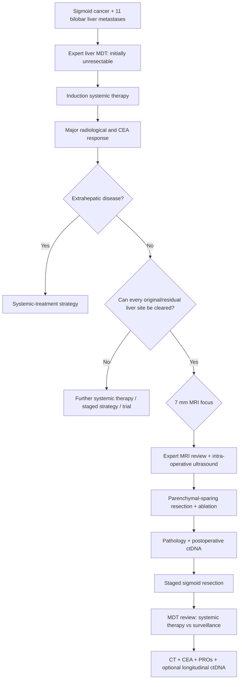
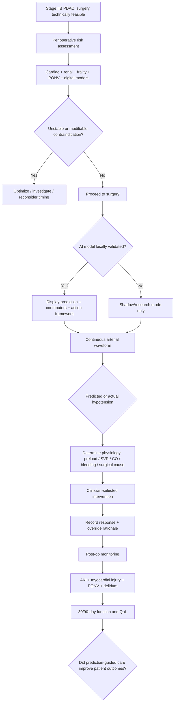

# Two fictional MDT cases: colorectal conversion and pancreatic perioperative risk

Academic biographies and contributor framing have been removed by authorization. All clinical case facts, supplied alternatives, timelines and illustrative scenarios are retained. Opaque citation tokens are source-supplied and unverified; they are not resolved references. Neither case represents real patient data or clinical treatment instructions.

## Colorectal source-supplied research context

PLCRC follows patients from primary diagnosis across stages I–IV while linking longitudinal clinical information with biospecimens and repeated patient-reported outcomes. citeturn22search5turn22search9

**Source-supplied publications; not independently verified**

| Publication | Why it is representative |
|---|---|
| *Sequential versus combination chemotherapy with capecitabine, irinotecan, and oxaliplatin in advanced colorectal cancer (CAIRO).* Lancet, 2007. | Landmark Dutch phase III work on systemic-treatment strategy in advanced CRC. citeturn15search0 |
| *Chemotherapy, bevacizumab, and cetuximab in metastatic colorectal cancer.* NEJM, 2009. | CAIRO2: directly reflects biomarker-informed systemic therapy and the complexity of combining targeted agents in mCRC. citeturn22search8turn22search20 |
| *Maintenance treatment with capecitabine and bevacizumab in metastatic colorectal cancer (CAIRO3).* Lancet, 2015. | CAIRO3 showed longer PFS2 with maintenance capecitabine/bevacizumab than observation—11.7 vs 8.5 months, HR 0.67—without clinically compromising global quality of life. citeturn15search1 |
| *The Prospective Dutch Colorectal Cancer (PLCRC) cohort: real-world data facilitating research and clinical care.* Scientific Reports, 2021. | Longitudinal clinical data, tissue/blood sampling, PROs and learning from routine care. citeturn22search5turn22search9 |
| *Real-world patient-reported outcomes in stage II/III rectal cancer in the Netherlands.* JCO, 2026. | Illustrates the present-day shift from conventional oncologic endpoints alone toward patient-reported and real-world outcomes. citeturn24view3 |

A particularly relevant contemporary backdrop for an MDT demonstration is **CAIRO5**, the Dutch randomized program in patients with initially unresectable colorectal liver metastases. The 2023 study specifically addressed whether induction systemic therapy can convert liver-only metastatic disease to curative-intent local treatment; later follow-up emphasized the importance of achieving complete local treatment and showed how difficult it remains to predict long-term outcome from baseline clinical variables alone. citeturn21search31turn21search7turn16search8

The **conversion-to-resection case combines imaging, molecular biology, ctDNA, real-world outcomes, quality of life and preference-sensitive decisions**.

## Colorectal MDT case — liver-only metastatic colorectal cancer after major conversion response

**Executive summary.** This is a deliberately difficult, entirely synthetic case of a fit 58-year-old patient with an asymptomatic left-sided colon primary and initially unresectable, bilobar, liver-only metastatic disease. After systemic induction therapy, conventional imaging shows a major response and the liver surgeons now believe all visible disease may be cleared using parenchymal-sparing surgery plus ablation. The difficulty is that several metastases have "disappeared" radiologically, circulating tumor DNA remains weakly positive, one tiny MRI lesion is indeterminate, the sigmoid primary remains in situ, and the patient has developed oxaliplatin neuropathy. The MDT therefore has to reconcile **radiological resectability, tumour biology, molecular data, cumulative toxicity, patient-reported outcomes and the patient's willingness to undergo aggressive curative-intent treatment**.

**All patient-specific details below are synthetic and do not describe a real patient.**

**Patient and presentation**

| Variable | Synthetic case data |
|---|---|
| Patient | Erik van D., 58-year-old man, Netherlands |
| Functional status | ECOG 0; independent; cycles 80–100 km/week before diagnosis |
| Social | Married; principal caregiver for wife with multiple sclerosis; two adult children |
| Occupation | Secondary-school physics teacher |
| Presenting complaint | Six weeks of altered bowel habit, intermittent blood loss and fatigue |
| Family history | Mother CRC age 76; otherwise no Lynch-spectrum clustering |
| Smoking/alcohol | Never-smoker; 5–7 units alcohol/week |
| Relevant comorbidity | Hypertension, BMI 29 kg/m²; mild non-alcoholic fatty liver disease |
| Medication | Amlodipine 5 mg daily; no anticoagulant/antiplatelet therapy |
| Patient priority | "I will accept major treatment for a genuine chance of long-term disease control, but I do not want permanent neuropathy for a treatment that is only buying a few months." |

**Diagnostic pathology and molecular profile**

Colonoscopy shows a partially circumferential ulcerating sigmoid tumour 28 cm from the anal verge; the scope passes easily and there is no current obstructive syndrome.

Biopsy is reported synthetically as **moderately differentiated colorectal adenocarcinoma**, CK20/CDX2/SATB2 positive, with intact mismatch-repair protein expression.

| Molecular test | Synthetic result | MDT significance |
|---|---|---|
| MMR/MSI | pMMR / MSS | No MSI-high phenotype |
| KRAS | Wild type, exons 2–4 | Keeps anti-EGFR treatment biologically plausible |
| NRAS | Wild type | Same |
| BRAF | V600E wild type | Removes a major adverse/targetable subgroup |
| HER2 | IHC 1+, no amplification | HER2-directed therapy not indicated on these data |
| NTRK | No fusion | No corresponding targeted option |
| PIK3CA | E545K mutation | Potential biological interest; not the immediate determinant of local therapy |
| APC | Truncating mutation | Supports colorectal molecular profile |
| TP53 | Pathogenic mutation | Supports colorectal molecular profile |
| Tumour mutational burden | 5 mutations/Mb | Low |
| Germline panel | No pathogenic Lynch/polyposis variant | Does not support a known hereditary syndrome |
| DPYD | No actionable deficiency variant identified | Allows standard fluoropyrimidine planning in the synthetic scenario |
| Baseline plasma ctDNA | Positive; dominant TP53 clone VAF 12.4% | Potential quantitative response marker |

The conflict between **anatomical resectability and residual molecular disease** requires explicit review of biomarker validation and treatment-selection limits.

**Baseline laboratories**

| Test | Result |
|---|---:|
| Haemoglobin | 7.7 mmol/L |
| Leukocytes | 7.8 ×10⁹/L |
| Platelets | 386 ×10⁹/L |
| Creatinine | 82 µmol/L |
| eGFR | >90 mL/min/1.73 m² |
| Bilirubin | 11 µmol/L |
| ALT | 44 U/L |
| AST | 37 U/L |
| ALP | 158 U/L |
| Albumin | 41 g/L |
| LDH | 286 U/L |
| CEA | **186 µg/L** |
| CA19-9 | 71 kU/L |

**Initial staging and imaging.** Contrast-enhanced CT chest/abdomen and hepatobiliary-phase liver MRI identify **11 bilobar liver metastases**. The largest is a 57 mm segment VIII lesion touching the right hepatic vein; other deposits involve segments II, III, IVa, IVb, V, VI and VII. Two lesions sit close to the middle hepatic vein. There are no pulmonary, peritoneal, osseous or non-regional nodal metastases.

The sigmoid lesion extends into pericolic fat with several suspicious regional nodes, yielding the synthetic clinical stage **cT3 cN1 M1a, stage IVA**. Under AJCC eighth-edition definitions, M1a denotes metastasis to one distant organ/site without peritoneal metastasis, which is the structure intentionally reproduced here. citeturn15search2

| Staging component | Synthetic assignment | Reason |
|---|---|---|
| Primary | cT3 | Extension beyond muscularis propria into pericolic tissue |
| Nodes | cN1 | Regional suspicious nodes |
| Metastases | **M1a** | Liver is the sole distant site; no peritoneal disease |
| Overall | **Stage IVA** | Any T/any N with M1a disease citeturn15search2 |
| Liver technical status at baseline | **Initially unresectable** | Bilobar distribution and inadequate predicted future liver remnant for a conventional major resection |

This overall scenario deliberately resembles the population studied in CAIRO5: patients with initially unresectable colorectal liver metastases who might become candidates for curative-intent local treatment after induction systemic therapy. citeturn21search31

**Imaging mockups for the demo.** The baseline axial CT should show multiple low-attenuation bilobar lesions, with the largest lesion abutting the right hepatic vein. The MRI should show diffusion restriction and hypointensity on the hepatobiliary phase. For a realistic image source/reference set, the Cancer Imaging Archive maintains a colorectal-liver-metastasis imaging collection with DICOM studies and segmentations: `https://www.cancerimagingarchive.net/collection/colorectal-liver-metastases/`. citeturn12search19

A particularly effective app visualization would overlay the **11 original lesion contours** on the follow-up MRI, allowing the MDT to see where radiologically "disappeared" metastases were located.

**Treatment and response timeline**

| Synthetic date | Event | Key findings / decision |
|---|---|---|
| 12 Jan 2026 | Colonoscopy + biopsy | Sigmoid adenocarcinoma |
| 16 Jan | CT chest/abdomen | 11 bilobar liver metastases; no extrahepatic disease |
| 20 Jan | Liver MRI | Confirms extensive bilobar disease |
| 23 Jan | Molecular MDT | MSS, RAS/BRAF WT; ctDNA positive |
| 26 Jan | HPB MDT | Liver disease judged initially unresectable |
| 2 Feb | Induction starts | mFOLFOX6 + bevacizumab, synthetic regimen |
| 30 Mar | After 4 cycles | CEA 186 → 46; RECIST-like reduction ~38%; ctDNA VAF 12.4% → 1.1% |
| 25 May | After 8 cycles | CEA 19; approximate aggregate diameter reduction 54%; ctDNA VAF 0.18% but still detectable |
| 28 May | Hepatobiliary MRI | Six clear residual lesions; three original deposits no longer visible; two tiny scars; one new/previously occult 7 mm segment IVa focus uncertain |
| 1 Jun | Toxicity review | ECOG 1; grade 2 sensory neuropathy, mild fatigue; patient wants treatment break |
| 4 Jun | **Second HPB MDT** | Surgeons believe complete local clearance may now be feasible |

The principal scientific tension here is intentional: **radiology says "possibly curable"; ctDNA says "residual systemic disease may persist"; toxicity says "stop oxaliplatin"; and the patient says "pursue cure, but preserve function."**

**Differential diagnosis for the 7 mm segment IVa MRI focus**

| Possibility | Findings supporting it | Findings against it | MDT consequence |
|---|---|---|---|
| Small residual/new CRC metastasis | DWI restriction; hepatobiliary-phase defect; metastatic background | Not confidently visible on baseline CT | Include in operative/ablation map |
| Previously occult metastasis now conspicuous after treatment | Retrospective subtle baseline MRI abnormality | Apparent "newness" creates progression concern | Does **not necessarily** imply true progression |
| Chemotherapy-associated focal hepatic change | Treatment-related liver changes present | Restricted diffusion makes this less comfortable | Repeat expert MRI review |
| Benign cyst/hemangioma | Small size; potentially longstanding | Signal pattern not classic | Observation only if expert radiology confidence high |
| Imaging artefact/perfusion phenomenon | Very small lesion | Reproducible on multiple sequences | Correlate with intra-operative US |

**The core staging question is no longer "Does he have stage IV cancer?" but "Has initially unresectable stage IV disease become completely locally treatable?"** CAIRO5 is directly relevant to this framing because its population was selected precisely around conversion from initially unresectable liver metastases toward complete local treatment. citeturn21search31turn21search7

**Treatment-strategy comparison**

| Strategy | Advantages | Main concern | Best argument for choosing it |
|---|---|---|---|
| Continue another 4 cycles systemic therapy | Tests disease biology longer; may further lower ctDNA | Neuropathy; disappearing lesions; chemotherapy-associated liver injury; possible loss of surgical window | MDT doubts current biological control |
| **Liver-first parenchymal-sparing resection + ablation** | Offers complete local treatment while limiting sacrificed liver volume | Microscopic systemic disease remains possible; several lesions have disappeared radiologically | Liver is dominant threat and primary is asymptomatic |
| Two-stage liver strategy ± portal-vein intervention | Can clear more complex bilobar disease | Two operations; dropout/progression between stages | One-stage clearance cannot achieve safe remnant |
| Simultaneous sigmoid + liver surgery | Single anaesthetic/recovery | Large combined physiological insult and higher complexity | Both procedures are modest and team is highly experienced |
| Continue systemic therapy without local treatment | Avoids major morbidity | Forgoes a current potentially curative window | New lesion proves systemic progression |
| Ablation/SBRT-heavy approach | Parenchymal preservation | Local control depends strongly on size/location | Surgery would sacrifice disproportionate liver volume |

CAIRO5 provides the strongest Dutch trial context for having this debate rather than treating "stage IV" as synonymous with permanently non-curative disease. The later analysis found the longest survival among patients able to undergo complete local treatment and also highlighted the potential role of repeated salvage local therapy after recurrence. citeturn16search5turn16search8

**Required MDT participants and anticipated viewpoints**

| Discipline | Likely contribution |
|---|---|
| Medical oncologist | Treatment response, systemic-control probability, cumulative oxaliplatin toxicity, subsequent systemic options |
| HPB surgeon | Whether every baseline site can be resected/ablated while preserving adequate functional liver |
| Colorectal surgeon | Timing of the intact asymptomatic sigmoid primary |
| Abdominal/hepatobiliary radiologist | Baseline-to-follow-up lesion mapping; whether the 7 mm focus represents progression |
| Interventional radiologist | Thermal ablation options for deep or parenchyma-expensive lesions |
| Molecular pathologist | RAS/BRAF/MMR/HER2 interpretation and concordance of tissue with plasma findings |
| Pathologist | Histological response after eventual resection and margin assessment |
| Radiation oncologist | Backup role for an anatomically difficult residual oligolesion |
| Oncology nurse / PRO specialist | Neuropathy, fatigue, daily functioning and caregiver burden |
| Clinical geneticist | Reassurance/interpretation of germline results and family implications |
| Trial/RWD coordinator | PLCRC-like longitudinal data, PRO collection and appropriate research opportunities |

**Specific MDT discussion prompts**

1. **Does persistent low-level ctDNA change intent?** Should molecular positivity delay potentially curative liver treatment, or is anatomical complete clearance still the dominant decision criterion?
2. **Is the 7 mm IVa focus true progression?** If radiology cannot resolve this, should it be treated empirically during liver surgery rather than triggering another systemic-treatment phase?
3. **What should be done with disappeared liver metastases?** Should every original site be explored with intra-operative ultrasound and treated where technically possible?
4. **One-stage, two-stage or liver-first?** Is a parenchymal-sparing combination of wedge resections and thermal ablation oncologically adequate?
5. **How much more oxaliplatin is justified?** Is additional cytoreduction worth the growing risk of persistent sensory neuropathy and surgical-liver toxicity?
6. **When should the intact sigmoid primary be removed?** Simultaneously, after liver recovery, or only after confirming absence of rapid extrahepatic progression?
7. **How should molecular data influence post-operative therapy?** Should postoperative ctDNA be used as a risk-stratification signal, an investigational endpoint, or a treatment determinant?
8. **What outcome matters to this patient?** How should a chance of durable remission be weighed against permanent neuropathy, repeated surgery and his caregiver responsibilities?

CAIRO3 formally incorporated quality-of-life considerations, while PLCRC connects routine oncologic data with repeated patient-reported outcomes. citeturn15search1turn22search9

**Recommended MDT plan for the synthetic demonstration.**

The preferred demo recommendation would be to **pause oxaliplatin-based induction now**, perform central expert rereview of baseline and current liver MRI with lesion-by-lesion mapping, and proceed to curative-intent liver treatment **provided all original and residual sites can be cleared with adequate liver preservation and no extrahepatic disease emerges**. A parenchymal-sparing resection/ablation strategy is preferable in the constructed scenario because conventional major hepatectomy would sacrifice substantially more normal liver.

The uncertain IVa lesion should be included in the intra-operative ultrasound and treatment map rather than automatically interpreted as systemic failure. The asymptomatic sigmoid primary would be treated in a staged fashion after recovery from the liver procedure, avoiding one excessively complex operation. Persistent ctDNA would be disclosed as an adverse biological signal but **not used alone to deny potentially curative local therapy**, because the synthetic purpose is to force the MDT to distinguish a promising biomarker from an independently validated treatment-selection rule.

**Follow-up framework for the demo:** pathology review and postoperative ctDNA at approximately four weeks; colorectal-primary surgery once hepatic recovery is adequate; systemic-treatment review after definitive local therapy; then close CT/CEA surveillance, initially roughly every three months, with ctDNA shown in the app as an additional longitudinal biomarker rather than a stand-alone trigger. Longitudinal neuropathy, fatigue, physical function and quality-of-life questionnaires should appear beside tumour markers in the dashboard—an intentional PLCRC-style design choice. citeturn22search9turn24view3

**Decision-flow visual**



## Perioperative source-supplied research context

The case asks whether **several individually reasonable algorithms generate recommendations, but clinicians must determine whether acting on them actually benefits the patient**.

**Source-supplied publications; not independently verified**

| Publication | Key relevance |
|---|---|
| *Incidence of intraoperative hypotension as a function of the chosen definition.* Anesthesiology, 2007. | Using a large automated perioperative dataset, demonstrated how strongly the apparent frequency of "hypotension" depends on the definition chosen—a foundational data/measurement problem. citeturn20search15turn18search1 |
| *Impact of risk assessments on prophylactic antiemetic prescription and the incidence of postoperative nausea and vomiting: a cluster-randomized trial.* Anesthesiology, 2014. | Automated risk information changed clinicians' prophylaxis behavior, yet the original assistive implementation did not improve PONV—an important lesson that prediction accuracy or changed behavior is not the same as patient benefit. citeturn17search2 |
| *Impact of adding therapeutic recommendations to risk assessments from a prediction model for postoperative nausea and vomiting.* BJA, 2015. | In 1,483 elective inpatients, adding actionable recommendations increased prophylaxis and was associated with lower PONV, particularly in high-risk patients. citeturn17search1 |
| *Associations between intraoperative hypotension, duration/depth and postoperative myocardial injury.* BJA, 2022. | Examines how hypotension exposure should be quantified and related to patient outcomes. citeturn20search19 |
| *Proactive vs Reactive Treatment of Hypotension During Surgery: the PRETREAT randomized clinical trial.* JAMA, 2025. | Randomized investigation of whether proactive blood-pressure management improves outcomes, moving from prediction toward intervention and patient-level benefit. citeturn19search0 |

The decision-support sequence is **define a risk correctly → predict it → expose the prediction to clinicians → attach an actionable recommendation → measure whether the intervention actually improves patient outcomes.** Each step must be tested rather than assumed. citeturn17search1turn17search2

## Pancreatic MDT case — high-risk pancreatic surgery with conflicting digital decision support

**Executive summary.** This synthetic case involves a 72-year-old woman with stage IIB pancreatic ductal adenocarcinoma scheduled for pancreaticoduodenectomy after neoadjuvant therapy. The cancer is technically operable, but the perioperative situation is difficult: chronic hypertension, CKD, HFpEF, moderate aortic stenosis, prior TIA, obstructive sleep apnea, mild frailty, high PONV risk and limited cardiopulmonary reserve. The EHR simultaneously generates a high hypotension-risk warning, an elevated cardiac-risk score, an AKI alert and a PONV recommendation. A locally developed machine-learning model proposes a higher intraoperative blood-pressure target, yet its calibration in pancreatic surgery is uncertain. The patient explicitly does not want "an algorithm deciding whether I go to ICU." The MDT therefore has to determine **which predictions deserve action, how much monitoring is useful, whether a high blood-pressure target helps or harms, who owns alerts, and how to combine algorithmic recommendations with physiology and patient goals**.

**All patient-specific values and algorithm outputs below are synthetic. No real UMC Utrecht algorithm or patient is being represented.**

**Patient profile**

| Variable | Synthetic data |
|---|---|
| Patient | Anneke J., 72-year-old woman |
| Diagnosis | Pancreatic ductal adenocarcinoma, pancreatic head |
| Planned procedure | Open pancreaticoduodenectomy |
| ECOG | 1 |
| Frailty | Mild; Clinical Frailty Scale recorded as 4 in demo |
| Hypertension | 20 years; home BP typically 150–165/75–85 mm Hg |
| Renal | CKD stage 3a |
| Cardiac | HFpEF; moderate aortic stenosis; no resting angina |
| Cerebrovascular | TIA 5 years previously, no residual deficit |
| Respiratory | OSA, adherent to nocturnal CPAP |
| Metabolic | Type 2 diabetes |
| Prior anaesthesia | Severe PONV after cholecystectomy |
| Smoking | Never-smoker |
| Patient priority | Survival from cancer, but preserving cognition and independent living is more important than "doing everything technically possible" |

**Medication list**

Candesartan 16 mg daily, amlodipine 5 mg daily, bisoprolol 2.5 mg daily, empagliflozin 10 mg daily, metformin 500 mg twice daily, atorvastatin 40 mg daily and pantoprazole 40 mg daily. Medication-specific perioperative withholding is intentionally left to the demo's institutional protocol rather than hard-coded into this synthetic case.

**Cancer pathology and molecular data**

Endoscopic-ultrasound-guided biopsy shows **moderately-to-poorly differentiated pancreatic ductal adenocarcinoma**.

| Marker | Synthetic result |
|---|---|
| KRAS | G12D |
| TP53 | Pathogenic mutation |
| SMAD4 | Retained by IHC |
| MMR | Proficient |
| BRCA1/2 | No pathogenic germline or somatic variant |
| PALB2 | No pathogenic variant |
| NTRK | No fusion |
| CA19-9 at diagnosis | 612 kU/L |
| CA19-9 preoperatively | 148 kU/L |

Pre-treatment imaging demonstrated a 3.4 cm pancreatic-head tumour and suspicious regional node without distant metastasis, yielding **cT2N1M0, stage IIB** in the synthetic scenario. NCI's AJCC-based pancreatic staging defines T2 as a tumour >2 cm and ≤4 cm, N1 as one to three involved regional nodes, and T2N1M0 as stage IIB. citeturn23search0turn23search3

After neoadjuvant therapy the primary measures 2.6 cm; there are no liver, lung or peritoneal metastases and no arterial encasement. The surgical oncology team regards an R0 resection as technically plausible.

**Staging and perioperative risk dashboard**

| Domain | Synthetic result | What it tells the MDT | What it does **not** tell the MDT |
|---|---|---|---|
| Cancer TNM | cT2N1M0, stage IIB | Oncologic extent | Operative physiological tolerance |
| ASA class | III | Global systemic-disease burden | Exact complication probability |
| RCRI | 2 | Elevated perioperative cardiac-risk category in the demo | Optimal MAP target |
| PONV score | 4/4 | Very high PONV phenotype in conventional scoring | Which implementation strategy will work locally |
| Frailty | CFS 4 | Reduced physiological/social reserve | Specific haemodynamic treatment |
| Locally displayed ML hypotension risk | 72% chance of >10 min MAP <65 mm Hg | High predicted hypotension burden | Whether acting on this prediction improves recovery |
| Locally displayed AKI model | 14% predicted postoperative AKI | Kidney deserves explicit protection/monitoring | Causal benefit of any particular alert-triggered intervention |

The distinction is **prediction versus actionable benefit**. The source-supplied PONV studies describe risk presentation altering clinician behavior without necessarily improving outcomes, whereas a more directive actionable recommendation produced a different clinical effect. citeturn17search1turn17search2

**Preoperative laboratory and physiological assessment**

| Test | Synthetic result |
|---|---:|
| Hb | 7.4 mmol/L |
| Platelets | 214 ×10⁹/L |
| Creatinine | 116 µmol/L |
| eGFR | 44 mL/min/1.73 m² |
| Sodium | 138 mmol/L |
| Potassium | 4.5 mmol/L |
| Albumin | 32 g/L |
| HbA1c | 56 mmol/mol |
| NT-proBNP | 486 ng/L |
| hs-Troponin T | 17 ng/L |
| Resting SpO₂ | 96% |
| CPET peak VO₂ | 14.1 mL/kg/min |
| Anaerobic threshold | 9.8 mL/kg/min |

Echocardiography: LVEF 58%, concentric LV hypertrophy, grade II diastolic dysfunction, left atrial enlargement, aortic-valve area 1.25 cm², mean gradient 18 mm Hg, preserved right ventricular function.

**Imaging mockups.** Use three synchronized panes in the app:

1. Portal-venous CT showing the pancreatic-head tumour adjacent to the SMV/portal confluence.
2. Echo still with LV hypertrophy and a calcified aortic valve.
3. A synthetic five-minute arterial-pressure waveform with an AI risk trace rising **before** MAP begins to fall.

For a public imaging reference, TCIA hosts pancreatic ductal adenocarcinoma imaging resources, including the CPTAC-PDA collection and associated image annotations. citeturn23search4

The key visual is not the tumour itself, however; it is the **perioperative dashboard** in which the algorithm gives a probability, the monitor gives physiology and the clinician has to decide whether either justifies intervention.

**Synthetic timeline**

| Date | Event | Decision point |
|---|---|---|
| 8 Feb 2026 | Pancreatic cancer diagnosed | Potentially resectable disease |
| Feb–May | Neoadjuvant systemic therapy | CA19-9 falls 612 → 148 |
| 1 Jun | Restaging CT | No metastases; surgery technically feasible |
| 5 Jun | Preoperative assessment | CKD/HFpEF/AS/TIA/OSA identified |
| 7 Jun | Digital risk engine | High hypotension, AKI and PONV warnings |
| 9 Jun | CPET/echo review | Limited reserve but no absolute cardiac contraindication identified in synthetic case |
| 10 Jun | **Perioperative MDT** | Proceed now, optimize/delay, monitoring strategy, BP target and postoperative location |
| 15 Jun | Planned surgery | Algorithmic vs physiology-guided management tested in demo |
| POD 0–2 | HDU/ward decision | Continuous monitoring vs standard observations |
| POD 3–7 | Recovery | AKI, myocardial injury, delirium, PONV and functional recovery become outcome dashboard |
| 30 days / 90 days | Follow-up | Function and QoL—not merely absence of hypotension—determine success |

**Differential diagnosis when MAP suddenly falls from 82 to 61 mm Hg during portal dissection**

| Cause | Supporting data the app can reveal | Immediate counter-evidence | Why AI alone cannot solve it |
|---|---|---|---|
| Relative hypovolemia / bleeding | Rising PPV, falling stroke volume, surgical-field blood loss | Hb trend initially unchanged | Prediction identifies impending hypotension, not its mechanism |
| Vasodilation from anaesthesia | Low SVR estimate, preserved/high CO | Timing during surgical traction | Treatment differs from low-output state |
| Reduced preload from venous manipulation | Abrupt SV fall during portal/SMV traction | Resolves when traction stops | Context lives partly outside monitor data |
| HFpEF / inadequate filling | LVH, diastolic dysfunction, low SV | Excess fluid may worsen pulmonary congestion | "Give fluid" can be harmful despite same MAP |
| Aortic-stenosis-related low output | Fixed outflow lesion, hypotension with reduced coronary perfusion | Moderate rather than severe AS | Requires haemodynamic interpretation |
| Myocardial ischaemia | ST change, new wall-motion change, troponin later | No baseline angina | Alert may occur before confirmatory evidence |
| Measurement artefact | Dampened arterial waveform | Normal clinical perfusion/second site | Poor input can create confident but meaningless predictions |

The source-supplied research describes the measured incidence of hypotension varying substantially according to the threshold and definition used. citeturn20search15

**Management-strategy comparison**

| Strategy | Benefit | Risk / limitation | MDT position |
|---|---|---|---|
| Standard reactive approach, treat established hypotension | Simple; familiar; fewer unnecessary interventions | May permit avoidable hypotensive exposure | Reasonable comparator |
| Fixed high MAP target because patient is "high risk" | Maximizes pressure margin | More vasopressor exposure; assumes risk score identifies who benefits | **Not automatically preferred** |
| ML early-warning alerts with protocolized intervention | Gives team advance notice | False positives, automation bias, model drift; treatment may target wrong physiology | Use only if locally validated and integrated safely |
| **Individualized physiology-guided strategy** | Uses MAP + CO/SV + surgical context + comorbidity | Requires expertise and appropriate monitoring | Preferred synthetic plan |
| Postpone surgery for prolonged optimization | More time for prehabilitation/cardiac review | Cancer-treatment delay; unclear whether risk becomes materially lower | Choose only if a modifiable contraindication is discovered |

PRETREAT moves the question beyond whether hypotension can be predicted toward whether **proactive treatment produces outcomes patients actually value**. The source describes a 2025 randomized trial. citeturn19search0

**Required MDT participants and likely perspectives**

| Participant | Likely perspective |
|---|---|
| Anaesthesiologist | Integrate risk predictions with actual haemodynamics; avoid blind adherence to thresholds |
| Pancreatic/HPB surgeon | Cancer is currently operable; unnecessary delay can sacrifice oncologic opportunity |
| Perioperative physician | Aggregate cardiac, renal, pulmonary, frailty and medication risk |
| Cardiologist | Determine whether AS/HFpEF are stable and whether further work-up would change management |
| Nephrologist | Protect renal perfusion while avoiding fluid overload |
| Intensivist | Decide whether planned postoperative ICU/HDU produces meaningful safety benefit |
| Geriatrician | Cognition, frailty, delirium vulnerability and functional trajectory |
| Acute-pain/PONV expert | Very high PONV risk; implement a genuinely actionable prophylaxis pathway |
| Clinical epidemiologist | Ask whether model discrimination/calibration and treatment-effect evidence apply to this patient |
| Data scientist / ML engineer | Explain model inputs, missing data, confidence, drift and out-of-distribution concerns |
| Clinical informatician | Decide how alerts enter workflow and who owns/responds to them |
| OR/HDU nurse | Expose alert burden, practical response times and workflow consequences |
| Patient/patient representative | Define acceptable trade-offs and consent for use of algorithm-supported care/data |

**Specific MDT discussion prompts**

1. **What exactly is the clinical problem the hypotension model solves?** Predicting MAP <65, preventing organ injury, reducing disability, or simply prompting clinicians earlier?
2. **Is the model valid for this patient?** Was it trained/calibrated in patients of similar age, procedure type, CKD burden and chronic blood-pressure distribution?
3. **Should chronic hypertension alter the target?** Does a home SBP around 160 imply she needs substantially higher intraoperative MAP, or would that inference produce excessive vasopressor exposure?
4. **Should the algorithm be prescriptive or assistive?** Should it merely display risk, recommend a specific intervention, or remain silent unless clinicians request it?
5. **How is cause distinguished from prediction?** When an alert fires, should treatment be fluid, vasopressor, inotrope, reduction in anaesthetic depth or correction of a surgical cause?
6. **What outcome defines success?** Fewer minutes below MAP 65, no AKI, no myocardial injury, less delirium, shorter admission, or preserved six-month functioning?
7. **How should her 4/4 PONV phenotype be handled?** Can the app convert risk into a concrete, protocol-linked recommendation rather than another passive warning?
8. **Does she need planned ICU/HDU admission?** Will continuous monitoring meaningfully alter outcomes, or simply generate more alarms and interventions?
9. **Who is accountable when clinician and algorithm disagree?** The anesthesiologist, institutional protocol, algorithm owner or software vendor?
10. **What does informed consent require?** The patient is comfortable with digital support but specifically rejects an autonomous "AI decision" about ICU admission or treatment escalation.

Displaying a prediction and delivering a useful, actionable recommendation are not interchangeable interventions. citeturn17search1turn17search2

**Recommended MDT plan for the synthetic demonstration.**

The demo MDT should recommend proceeding with surgery after confirming there is **no unstable cardiac condition or other correctable contraindication**, rather than postponing solely because several risk algorithms classify her as high risk.

The anaesthetic strategy should use invasive arterial-pressure monitoring plus enough haemodynamic information to distinguish **pressure, flow, preload and vascular tone**, instead of treating every predicted fall in MAP identically. A patient-specific pressure range should be agreed before surgery, but the app should explicitly show that this is a **clinical goal subject to physiology and context**, not an unquestionable AI threshold.

The predictive hypotension model should operate in one of two modes:

**Validated deployment mode:** if it has appropriate local validation, show the warning together with its physiological contributors and an intervention checklist; require clinician acknowledgment and record the reason for acting or overriding.

**Research/shadow mode:** if external or local validity is uncertain, calculate the risk silently for prospective evaluation without allowing it to dictate patient care.

The PONV module should behave differently: because the patient has an extreme conventional risk phenotype, it should generate an explicit protocol-linked multimodal prophylaxis recommendation rather than simply saying "high risk." That distinguishes assistive risk display from directive decision support; local protocol and clinician review remain required. citeturn17search1turn17search2

Postoperatively, the synthetic plan places her in an enhanced-observation/HDU setting initially, with kidney function, myocardial injury, delirium, nausea/vomiting, pain and mobilization displayed as **coequal outcomes**. After transition to the ward, continuous monitoring should only be used if the institution has a clear alert-response pathway. The app should subsequently show whether preventing hypotension actually translated into what the patient cares about: preserved cognition, independence and functional recovery.

**Decision-flow visual**



The last node asks whether the **clinical decision-support learning loop** helps clinicians make better decisions, rather than assuming an AI dashboard is beneficial.

## Demo visual package and interaction design

The two cases should look deliberately different in the MDT application because they demonstrate two complementary concepts.

For **colorectal conversion**, the centre of the screen should be the **disease trajectory**. Put the baseline liver map on the left, current MRI on the right and the molecular/clinical timeline below it. Each original hepatic lesion should retain a persistent identifier—L1 through L11—even when it becomes radiologically invisible. Clicking a lesion should show baseline diameter, current diameter, segment, relationship to vessels and proposed local treatment where supplied. A longitudinal strip should display CEA, ctDNA and patient-reported neuropathy/fatigue on the **same timeline** rather than placing PROs in a secondary screen.

**Mapping limitation:** the source supplies only five conceptual illustrated rows, not a measured eleven-site map. L6–L11 individual measurements, geometry and treatment allocations are not supplied. Do not invent them. A mockup's 0 mm/disappeared label means radiological invisibility, not eliminated disease.

A useful mockup could look conceptually like:

```text
BASELINE MRI                       AFTER 8 CYCLES
────────────────                  ────────────────
L1  Seg VIII  57 mm   ─────────▶  29 mm   [resect]
L2  Seg VII   31 mm   ─────────▶  14 mm   [ablate]
L3  Seg IVa   24 mm   ─────────▶   9 mm   [resect]
L4  Seg III   18 mm   ─────────▶   0 mm   [disappeared]
L5  Seg VI    14 mm   ─────────▶   0 mm   [disappeared]
...
                                      + 7 mm uncertain focus

CEA     186 ───── 46 ───────── 19 µg/L
ctDNA 12.4% ─── 1.1% ─────── 0.18%
PRO neuropathy  0 ─── grade 1 ─── grade 2
```

The primary visual reference can come from TCIA's colorectal-liver-metastasis dataset rather than using identifiable clinical material. citeturn12search19

For **pancreatic perioperative risk**, place the emphasis on **time, uncertainty and action**. Display the arterial waveform, MAP, stroke volume/cardiac output and an ML probability trace against a common clock. When the model triggers, pause the demo and let MDT participants vote among "fluid", "vasopressor", "reduce anaesthetic", "ask surgeon to stop traction", "additional diagnostic step" and "do nothing yet." Only then reveal additional physiology. A risk prediction is not itself a diagnosis or treatment. citeturn20search15turn17search1

A hypothetical, illustrative staged reveal would be (not observed physiology or an outcome):

```text
10:42:00   MAP 78      AI hypotension risk 22%
10:42:40   MAP 75      AI risk 48%
10:43:20   MAP 72      AI risk 81%     ← alert
10:44:00   MAP 66      SV falls 18%
10:44:20   MAP 61      portal traction begins
10:44:40   ???         ← PAUSE MDT HERE

Reveal after vote:
SVR normal-high
Stroke volume markedly reduced
Surgical field: active venous compression, little blood loss

Question:
Would the intervention selected from "MAP + AI probability" alone
have been the same after seeing mechanism/context?
```

A second screen should compare **algorithm performance with patient outcome**:

| Layer | Colorectal demo | Pancreatic demo |
|---|---|---|
| Prediction | Recurrence/response/ctDNA risk | Hypotension/AKI/PONV risk |
| Intervention | Systemic therapy + local treatment | Monitoring + haemodynamic/antiemetic action |
| Intermediate endpoint | Radiological response / ctDNA fall | Minutes below pressure threshold |
| Patient endpoint | Survival, function, QoL, neuropathy | AKI, MI, delirium, nausea, disability, QoL |
| Human choice | How aggressive should "curative intent" be? | When should an algorithm change treatment? |
| Learning-system element | PLCRC-like longitudinal outcome capture | Feed clinical response/outcomes back into CDS evaluation |

The **colorectal case asks whether increasingly rich biological and real-world data can improve treatment selection; the pancreatic case asks whether increasingly rich predictive data actually improve clinicians' decisions.** These are related but distinct problems.

## Assumptions, boundaries and direct-demo notes

Both patients, all names, dates, laboratory values, radiological measurements, molecular findings, algorithm scores, family/social circumstances and treatment trajectories are **synthetic**. They create meaningful disagreement in an MDT; they are not actual patient records or personal opinions of clinicians.

The **colorectal case does not allow ctDNA to become an automatic treatment command**. Distinguish a prognostic or investigational biomarker from a fully validated decision rule.

The **pancreatic case labels its ML hypotension and AKI probabilities as fictional**. No values or thresholds are outputs of a real UMC Utrecht model. A technically successful prediction is not proof of clinical benefit. citeturn17search1turn17search2

**Unresolved source caveats:** the CKD stage 3a label and eGFR 44 are both retained without silently reconciling the mismatch; RCRI 2 is source-reported and unverified. The hypotension prose starts at MAP 82 while the staged reveal starts at 78; both are illustrative, not observations. Risk-model calibration is unknown; medication withholding is unspecified and requires the institutional protocol. Neoadjuvant pancreatic regimen and doses are not supplied. The planned postoperative events and follow-up endpoints are not completed surgery or measured recovery outcomes.

The proposed management pathways are **conditional educational MDT discussions for a demonstration, not clinical treatment instructions or automatic treatment selections**. They require targeted human imaging/anatomical and physiological review, role-scoped follow-up, current-version human review, and local protocol access. Additional consultation perspectives are consolidated within seven existing roles, not impersonated clinicians, extra votes or invented approvals.