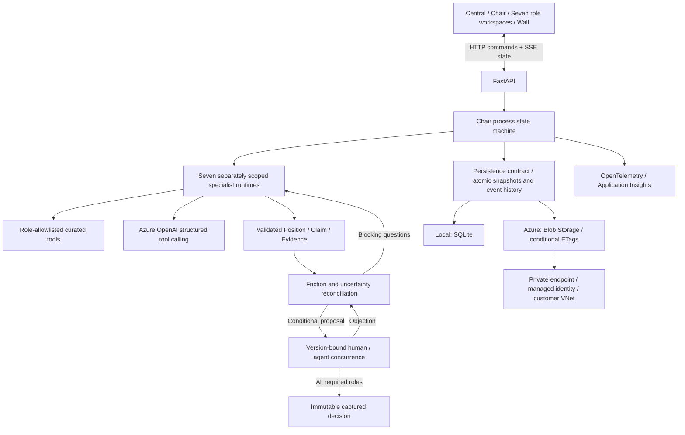

# Architecture and invariants

The runtime is separate from MDT orchestration. Rehearsal and Azure runtimes
implement the same `analyze` contract. Rehearsal deterministically executes the
curated tools; Azure chooses allowed tools and produces a validated structured
position. The process state machine and approval gates are application code,
not model instructions that a generated response can override.

The React interface uses Tailwind utilities over shared light/dark theme tokens.
Specialty workspaces use different information structures and color treatments:
image comparison, treatment/toxicity review, surgical readiness, tissue findings,
evidence applicability, pathway conditions and patient priorities. A persisted
theme preference is applied before paint, with a system default and optional
`scoutTheme` URL override.

The application is framed as a module of a fictional hospital information
system (`HospitalChrome.tsx`): a navy hospital header names the MDT room and the
current workstation (for example "Radiologist workstation" or "MDT chair"), and an
EHR-style patient banner repeats the case pseudonym, sex/age, case reference,
diagnosis, stage, performance status and spoken language on every meeting screen.
The banner reads only fields in the case record, never invents demographics or
allergies, and labels the record fictional.

Specialty screens put the role identity, attention cue, public assessment,
newest-first activity and human controls in the center. A sticky desktop case
rail keeps terse case facts and full-record access on the right. Full specialty
source workspaces and saved preferences remain expandable; full assessments and
proposal conditions open in inspection drawers. The same version-bound review
form is reused by the specialist, central and chair desks.

Each role retains its own canvas, header, icon and source-record layout.
The desktop navigator stays available while scrolling; switching workspaces
returns to the top. Color is an orientation cue, not an approval. Attention
labels distinguish running review, failure, unresolved questions, changed
versions, human concurrence and agent support. A 900 ms entry animation eases
public updates only; it never delays state, errors or review controls, and is
disabled for reduced motion.

The entry screen lists the authenticated `/api/cases` catalog and offers a
separate resume action. The browser posts the selected `case_id` when starting.
Unknown IDs are rejected before replacing or persisting a meeting; active rounds
still prohibit replacement. Omitting `case_id` remains backward-compatible with
existing API callers. Three dossiers are configured: the original BRAF-mutant
colorectal case, a separate RAS/BRAF-wild-type colorectal conversion case, and
a pancreatic/perioperative case. `case_registry.py` returns private copies of
each case's record, role contexts, evidence and runtime policy. Selection never
changes shared module globals. Tools, prompts, friction, proposals and memory
cards remain bound to that case; unrelated saved patient memories are excluded.
Every case supplies the same runtime policy, so the chair and the specialist
runtime hold no per-case branches: adding a case is a content change in
`case_registry.py` and its dossier, not an engine change.

Live model payloads retain all distinct clinical source values while referencing
duplicate table/projection content only once. Shared evidence limitations are
indexed explicitly rather than repeated; source passages, access status and
citation metadata remain in the request. Full quantitative scrutiny, original
role-context shapes and complete tool results stay in the UI, events and exports.
Follow-up requests add only new findings and explicitly retain earlier conditions.
This keeps the existing bounded runtime without discarding source facts or
relaxing its token, retry or review gates.

Clinical activity presentation is separate from the technical audit. Clinicians
see the assessment being performed, available findings and unresolved questions;
provider/request/token metadata stays in exports and telemetry. Errors remain
visible in actionable language rather than being disguised as completed reviews.
Operational failures, queue waits and retry notices stay in the activity/audit
stream; they do not replace the next clinical question. Legacy snapshots with a
technical failure in that field are presented as a visible review failure,
without rewriting the stored meeting or hiding the failure.

## Shared contracts

`src/mdt/models.py` defines the typed contracts consumed by persistence, the API
and the browser. Positions contain cited claims, uncertainty, stance, autonomy,
friction keys, public assessment summaries and provenance. Evidence includes
source geography, access status, supporting data, limitations and study scrutiny.
The UI never displays raw model chain of thought.

An event has a meeting ID, monotonic sequence, timestamp, type, optional role
and structured payload. Every event persists a transactional snapshot before
it is broadcast. The chair serializes the meeting once per event; the same bytes
are written to storage and sent to every stream. Storage calls run on one
dedicated worker thread, so a slow Blob write never blocks the event loop, health
probes or open streams, while the single worker keeps writes in event order and
the chair lock still admits one transition at a time. Reads of the active meeting
take the same lock, so they never observe a half-applied transition.
`EvidenceFound` events and activity reference evidence already held in the
meeting by `evidence_id`; a record that differs from the meeting's copy is kept
in full, so exports remain a complete audit record.
SSE transports complete snapshots; bounded subscriber queues
coalesce intermediate renders without deleting persisted audit events. Reconnect
always receives the latest full state, so a stale event cursor cannot drop state.

Screens subscribe to the room, not to one meeting. `GET /api/room/stream` is opened
by every screen as soon as it loads and carries an envelope, `{"meeting": <snapshot>}`
or `{"meeting": null}` for standby, so an empty room is unambiguous rather than
indistinguishable from a broken transport. A screen opened before any case exists is
therefore already attached and populates when the orchestrator starts one, and a
screen showing one meeting is replaced when a different meeting is started.
`POST /api/room/clear` empties the room back to standby. It is refused while a round
is running, and it clears rather than deletes: the meeting stays persisted, readable
and exportable by ID, while mutations against the cleared room return 404. The reset
is durable — it is written through the normal persistence path as a `RoomCleared`
audit event on the meeting and restored on startup — so a restart cannot return a
closed case to the participants' screens, while an uncleared room still resumes.

## Outcome communications

Once the decision is captured, the engine drafts two documents from the recorded
outcome: a patient summary and a letter for the GP or referring colleague. The
runtime (`communications.py`) is separate from the chair state machine. It reads
a role-scoped copy of the record: plan, conditions and frictions for both
documents. The patient summary also gets the patient-perspective position and
priorities. The letter also gets every specialist position, concurrences,
objections and metadata for the evidence the plan cites. It never reads raw
events, tool traces or prompts.

- **Skills, not scripts.** `skills/patient_summary.md` and `skills/clinician_letter.md`
  are case-agnostic writing instructions. The patient summary uses the dossier's
  `preferred_language` (en, de, it or nl); an unsupported language is refused
  rather than guessed. The letter is always British English.
- **Always a model, never a fallback.** Documents are drafted by the configured
  Azure OpenAI deployment in both rehearsal and live meetings, with structured
  output and no tools. Without a model, or on any failure, the document is FAILED
  with a visible reason, and no scripted text is substituted.
- **Validation.** A draft that cites unknown record references, contains URLs or
  identifiers, is in the wrong language or has the wrong section order is rejected.
- **Advisory checks and one self-revision.** Readability uses a per-language
  formula: Flesch (EN), Amstad (DE), Gulpease (IT) or Flesch–Douma (NL). Other
  checks cover length, sentence length, unexplained terms, numbers absent from
  the record and plan coverage. If a target is missed, the model revises exactly
  once; any remaining findings are shown to the reviewer.
- **Human approval.** Only a named reviewer can approve, and approval binds to
  the plan version and document revision. Requesting changes redrafts the
  document as a new revision and revokes any earlier approval.
- **Lifecycle.** A new case cannot start while a document is drafting, which is
  bounded by the 300-second deadline. On restart, an interrupted draft becomes
  FAILED with a recorded reason. Clearing the room keeps the documents in the
  persisted meeting and export.

## Workflow invariants

- Only one mutating analysis round can run in the active room.
- Every role must have a valid position before synthesis; errors block progress.
- Friction reflects current structured positions, never elapsed demo time.
- Follow-up targets roles named by unresolved questions.
- Human steering changes only the chosen role and clears prior concurrence.
- REVIEW and ESCALATE positions cannot auto-concur.
- A human objection records dissent, reopens discussion and requires fresh
  concurrence; the objecting role cannot later auto-concur.
- Closure requires all seven roles concurring on the current plan version and
  zero blocking friction.
- Uncertainty, missing full protocol access and conditional eligibility survive
  convergence; agreement is not represented as clinical certainty.
- Interrupted analysis is marked ERROR after restart and can be retried.
- Outcome documents are drafted only after the decision is captured, only from
  the recorded outcome, and are never shared as approved without a named,
  version-bound human approval.

## Deliberate trade-offs

Single-process async orchestration is sufficient for one live demo room and
avoids distributed orchestration infrastructure. SQLite stores local snapshots.
On Azure, the same persistence contract writes atomic JSON blobs including the
event history. Managed identity and a private endpoint comply with inherited
policies that prohibit public storage access and REST Shared Key authentication.
ETags reject stale writes. This is not a distributed event store or a multi-writer
service; deployment deliberately allows one active revision and replica.
Whole-snapshot writes keep recovery trivial but rewrite static dossier content on
every event (19–40 MB per initial rehearsal round, depending on the case); an
append-only event log would cut this further at the cost of the snapshot invariant.
Within that process, independent specialist reviews can overlap. Concurrency is
configurable from one to seven (default three); request pacing and provider
cooldowns are shared across roles. Increasing concurrency does not create more
model quota or relax the chair's review and concurrence gates.

Model requests allow 90 seconds of read inactivity, with 10-second connection
and pool limits and a 30-second write limit. All roles share one model client
and managed-identity credential per process, so tokens and connections are reused;
a changed endpoint or key rebuilds it, and application shutdown closes it.
One timeout/connection retry is
allowed per request after a two-second pause and the existing shared pacing.
Rate-limit retries retain their separate two-retry budget and server cooldown.
Retries stay inside the existing 300-second active-role deadline; they do not
re-execute completed local tools or publish failed attempts. Timed-out remote
inference may still consume provider tokens; unknown usage is not claimed as
measured usage. Exhaustion remains a visible failed review, never a rehearsal
fallback or an automatic clinical decision.

Storage failures pause the meeting visibly and cancel its analysis round.
Retry reloads durable state before resuming; it does not claim unsaved decisions
were captured. A larger product would need transactional cross-record operations,
durable task scheduling, formal clinical identity and governance.

The initial SMB deployment could not mount storage because inherited policy
disabled its public endpoint. No exception was deployed. Cloud persistence was
changed to managed-identity Blob access over a customer-VNet private endpoint.
The unused original application and its scoped identity roles were retired after
the private-network deployment passed acceptance; it never accepted a cloud
clinical/demo decision. Existing storage data was preserved.

The evidence collection is versioned demonstration material. Curated sources
are not advertised as real-time searches. Supplied case assertions are
explicitly distinct from external claims. Real medical use would require
independent clinical, regulatory, privacy and safety validation.

The original colorectal-conversion dossier is derived from `case.md`; both
distinct narratives in `case_2.md` are independently packaged. Complete records
are copied into meetings so exports and restart recovery preserve the case
discussed. Specialty projections do not replace the full record. Academic
profiles and framing contributors were removed from supplied repository documents
at the user's request; clinical data are retained and source hashes updated.
Historical meetings are never rewritten; unsupported case IDs remain
review/export-only. The pancreatic case incorporates perioperative consultations
within the existing seven workspaces, not additional invented human sign-offs.
Illustrative model probabilities and staged physiology are not validated
predictions, measured waveforms or automated clinical decisions.

## Instrumentation

OpenTelemetry records API requests, role analysis, model/tool operations and
workflow counters. Application Insights receives a `mdt-observatory` service
resource. Workflow logs contain IDs, role names and event types, not patient
data, guidance or prompts. Health probes and long-lived SSE HTTP spans are
excluded to avoid noise; application events still capture the workflow.
